# VMC (Vseslav Makarov Camera) 8.8
### Next-Generation Computational Photography: Comprehensive Technical Audit, Core Engine Architecture, and Dual-Corner Viewfinder HUD

[](https://github.com/vseslav-makarov/vmc-camera/releases)
[](https://github.com/vseslav-makarov/vmc-camera)
[](LICENSE)
[](https://developer.android.com)
[](https://www.celsoazevedo.com/files/android/google-camera/)
[](https://www.celsoazevedo.com/files/android/google-camera/)
[](https://store.google.com/category/phones)
[](https://qualcomm.com)
[](https://developer.qualcomm.com)
[](https://www.arm.com/technologies/neon)
[](https://sony-semicon.com)
[](https://leica-camera.com)
[](https://github.com/mozilla/mozjpeg)
[](https://ai.googleblog.com/2018/10/see-better-and-further-with-super-res.html)

🌐 **Language / Язык:** **[English](README.md)** | **[Русский](README_RU.md)**

**VMC (Vseslav Makarov Camera)** is a high-performance software-hardware computational photography suite for the Android operating system. The project originated as a deep architectural overhaul of the **LMC 8.8 mod (Google Camera 8.8.224 by Hasli fix)** and, through 93 rigorous engineering iterations, evolved into an independent camera platform featuring a closed-loop hardware auto-calibrator, direct DSP/NPU compute core addressing, and an industry-first dual-corner viewfinder control interface.

I really liked how the HDR++ algorithm (#google-camera) worked in the BSG mods (version 5.1). With all due respect to BSG, my own work is inspired by that wonderful era (2018–2020) a time when you could simply install an APK, toggle the HDR+ switch, make a few minor adjustments, and end up with a masterpiece. This is likely due to the tone-mapping model used in Google’s GCam 2 and 3 (#google). It’s striking that photos taken on the latest Google Pixel (#pixel) phones now often look flat and gray, whereas, back in the early days of computational photography, they were remarkable for their depth and color.

All photographs produced by the application embed an authoritative digital signature in the EXIF metadata: `Camera by Vseslav Makarov`.

> 📖 **Author's Manifesto:** [Why Stock OEM Cameras Hit a Dead End and How VMC Was Built (Read Article)](WHY_VMC_EN.md) — detailing months of low-level debugging, eliminating hex-patching, and revolutionizing in-viewfinder frame physics control.

---

## 🏛️ Architectural Evolution Map (From LMC 8.8 fix to VMC v93)

```mermaid
flowchart TD
    subgraph Stage1 ["Stage 1: Base LMC 8.8 fix (v16)"]
        S1_DSP["Hexagon DSP Disabled (pref_hexagon = 0)"]
        S1_RS["Watercolor RAISR2020 Resampling"]
        S1_AWB["Averaged AWB (Green tint in IMX686 shadows)"]
        S1_MRG["Random fallback of multi-frame burst to 1 frame"]
        S1_UI["Cluttered menu curtain, empty viewfinder"]
    end

    subgraph Stage2 ["Stage 2: Configuration Evolution (v17 — v42)"]
        S2_HVX["Hexagon HVX 698 enabled for RAW processing"]
        S2_LNZ["3-lobe Lanczos spatial filter"]
        S2_SBR["Sabre Super-Res 1.5x sub-pixel synthesis"]
        S2_BL["Black Level calibration (64.20 / 64.10)"]
        S2_DRC["Leica Authentic exposure curve (-0.67 EV)"]
        S2_ST["Color styles: Dynamic, Classic, Film"]
    end

    subgraph Stage3 ["Stage 3: MakCam Engine v31 — v40"]
        S3_BRND["Isolation into independent binary"]
        S3_NOP["AutoHighlightPatch: ARM64 NOP highlight fix"]
        S3_C2["Camera2 ID mapping: Main 0, Tele 2, Wide 3, Front 1"]
        S3_NOISE["Hardware noise profiles mapped to physical sensors"]
    end

    subgraph Stage4 ["Stage 4: VMC Platform v41 — v63"]
        S4_PKG["Independent Package ID com.google.android.vmcamera"]
        S4_JTB["TurboJPEG 3.2.1 NEON SIMD (3.5x acceleration)"]
        S4_YUV["Native YUV Decoder (Clang 21 ARMv8-A + SIMD)"]
        S4_ONNX["ONNX Runtime 1.29 + QNN HTP v75 NPU"]
        S4_SAMS["Resolution of Exynos s5e8855 crash (Galaxy A56)"]
        S4_TIERS["6 illumination tiers & real-time CCT scene spectrometer"]
    end

    subgraph Stage5 ["Stage 5: Dual-Corner HUD UI Revolution (v64 — v86)"]
        S5_BL["Bottom-Left: EV Switcher + Focus + Aperture"]
        S5_TR["Top-Right: Live CCT, DSP, and RAW burst telemetry"]
        S5_CARD["Unified Bracket Card UI on dark ScrollView"]
        S5_LIFECYCLE["Smooth auto-synchronization with GCam lifecycle"]
    end

    subgraph Stage6 ["Stage 6: Next-Gen Flagships (v87 — v92)"]
        S6_X14U["Xiaomi 14 Ultra (LYT-900 1-inch + 8 Gen 3)"]
        S6_APER["Physical Aperture f/1.63 - f/4.0 (9-step SeekBar)"]
        S6_ISZ["In-Sensor Zoom 1.0x - 1.2x - 1.5x - 2.0x"]
    end

    subgraph Stage7 ["Stage 7: Release Finalization & Protection (v93)"]
        S7_SHARP["Fix detail drop (PolySharp Med Radius = 1)"]
        S7_AWB["Elimination of green asphalt in shadows (R >= 1.82)"]
        S7_DRC["Protective exposure threshold (-0.333 EV)"]
        S7_OBF["Obfuscation: llvm-strip --strip-all, d8 --release"]
        S7_LIC["Proprietary Source-Available EULA"]
    end

    Stage1 --> Stage2
    Stage2 --> Stage3
    Stage3 --> Stage4
    Stage4 --> Stage5
    Stage5 --> Stage6
    Stage6 --> Stage7
```



---

## 🌟 1. First in Industry Innovations

### 1.1. Dual-Corner Viewfinder HUD (Direct In-Viewfinder Controls)
For the first time in Google Camera ports and mobile imaging applications, essential sensor parameters and computational settings have been extracted from deeply nested configuration menus and mapped directly into an ergonomic diagonal layout across the active viewfinder:

```
┌──────────────────────────────────────────────────────────────────┐
│ [● HDR++ · ready] [AI Dynamic ▾] [☁️ ~9500K] [kHexagon: 12/12]   │ ➔ Top-Right HUD:
│                                                                  │   Real-time analytics,
│                                                                  │   acceleration status & menu
│                                                                  │
│                        LIVE VIEWFINDER                           │
│                                                                  │
│                                                                  │
│ [EV -0.7] [AF Auto] [f/1.63]                                     │ ➔ Bottom-Left HUD:
│ [        EVDialView        ]                                     │   Direct physical sensor
│   (1.0x)   (1.2x)   (1.5x)   (2.0x)                              │   control (EV, Focus, Aperture)
└──────────────────────────────────────────────────────────────────┘
```

#### 📍 Bottom-Left Corner — Direct Physical Sensor & Optics Control:
1. **EV Switcher (Interactive Exposure Compensation):**
   * Instant single-tap cycling through exposure tiers: `-0.7` ➔ `-0.3` ➔ `0.0` ➔ `+0.3` ➔ `+0.7`.
   * Long-tap reveals the circular **EVDialView** directly above the buttons for single-thumb brightness fine-tuning without obscuring the center framing.
   * Long-press resets exposure to neutral.
2. **Focus Switcher (Focus Drive Selector):**
   * Seamless switching between 4 modes: `AF Auto` (phase-detection autofocus) ➔ `Macro` (minimum distance) ➔ `Infinity / Hyperfocal` (one-tap landscape sharpness) ➔ `Manual Focus (MF)`.
   * In manual mode, provides real-time feedback with an exact sensor diopter ($dpt$) scale.
3. **Aperture Switcher (Physical Variable Aperture Control):**
   * *First ever implementation in Google Camera ports for Xiaomi 14 Ultra (`aurora`) and Xiaomi 13 Ultra (`ishtar`)!*
   * **Quick Click:** Cycles through standard aperture presets: `f/Auto` ➔ `f/1.63` ➔ `f/2.0`.
   * **Long Click:** Opens a precision **SeekBar dialog offering 9 physical lens aperture steps**:
     $$\mathbf{f/1.63 \quad f/1.8 \quad f/2.0 \quad f/2.2 \quad f/2.5 \quad f/2.8 \quad f/3.2 \quad f/3.5 \quad f/4.0}$$
   * **Hardware Routing:** Synchronously transmits commands via the standard Android `CaptureRequest.LENS_APERTURE` key and Xiaomi's proprietary vendor tag `com.xiaomi.lens.aperture`.
   * **Intelligent Visibility Control:** The button dynamically appears only on supported camera modules with physical variable blading and automatically hides when switching to ultrawide or telephoto lenses.

#### 📍 Top-Right Corner — Analytics Overlay, HEX/CPU Indicator & Professional Quick-Settings Curtain:

1. **Dynamic Hardware Acceleration Indicator (`HEX` vs `CPU`):**
   * Real-time in-viewfinder display of the active computational execution core:
     * **`HEX` (`kHexagon`):** Hardware processing on Qualcomm Hexagon DSP (HVX) via FastRPC. Delivers maximal burst merge throughput, minimal power consumption, and zero thermal throttling.
     * **`CPU` (`kCpu`):** Software fallback to Kryo/Oryon CPU cores. Instantly alerts the user of DSP queue saturation or driver incompatibility.
   * Auxiliary coprocessor status: `QNN HTP v75` (Snapdragon 8 Gen 3 NPU) and TurboJPEG NEON SIMD hardware decoder.

2. **HDR+ Enhanced Processing Readiness Indicator:**
   * Real-time monitoring of the Zero Shutter Lag (ZSL) ring buffer depth and frame queue allocation in system RAM.
   * Dynamic readiness marker for heavy multi-frame burst capture (15–36 RAW frames) without shutter lag or queue drop risk.

3. **Live Denoise Monitoring & In-Flight Gain Adjustment:**
   * Continuous monitoring of spatial ($G_{spatial}$) and temporal ($G_{temporal}$) noise suppression coefficients.
   * Real-time in-viewfinder slider to adjust Luma and Chroma noise reduction on the fly without restarting the Camera2 capture session.

4. **Hot-Swappable Tone-Mapping Model:**
   * Seamless in-flight switching between dynamic range transfer curves without pipeline reinitialization:
     * **`HDRnet Neural`:** Google's adaptive neural network tone compensation with local tone mapping.
     * **`Filmic Tone-Curve`:** Cinematic S-curve highlight roll-off with rich mid-tone contrast.
     * **`Reinhard Extended`:** Classic exponential high-dynamic-range tone mapping.
     * **`ACES / Rec.709 Spline`:** Motion-picture industry color adaptation standard with natural skin-tone gradations.

5. **Hot-Swappable Color Space Engine:**
   * Instant color gamut selection during composition:
     * **`DCI-P3 (Wide Color Gamut)`** / **`Display P3`** — extended cinematic color space for modern flagship displays with deep spectral hues.
     * **`sRGB`** — standard web color space for broad compatibility.
     * **`Rec.2020`** — next-generation ultra-wide broadcast gamut.
   * Automatic per-frame chromatic adaptation transform (Bradford CAT / CAT02).

6. **Hot-Swappable AWB Engine:**
   * Runtime selection between neutral point computation algorithms:
     * **`Google Neural AWB`:** Pixel convolutional neural network white balance classifier optimized for complex mixed-light scenarios.
     * **`Vendor Hardware ISP AWB`:** Qualcomm Spectra 3A hardware block with zero latency.
     * **`Hybrid CCT Matrix`:** Direct calculation from raw sensor neutral points with per-frame Kelvin ($CCT$) interpolation.

7. **Real-Time Color Correction & CCM Tuning:**
   * Dynamic Color Correction Matrix ($3\times 3$ CCM) bias adjustment.
   * Hardware neutral point clamping (`clampAwb`), completely preventing green color shifts on Sony IMX686 sensors in overcast conditions and allowing real-time saturation/chroma gain tuning.

8. **Hot-Swappable Exposure Bracketing Engine:**
   * Professional multi-frame exposure merging subsystem:
     * **`Auto (Adaptive Scene-Luminance)`:** Automatic exposure step calculation based on live scene dynamic range.
     * **`Curated Presets`:** *Extreme HDR* ($\pm 2.0$ EV), *Shadow Boost* ($+1.5$ EV), *Highlight Preservation* ($-1.5$ EV).
     * **`Parametric Manual`:** Explicit configuration of burst series count, frame depth ($N \in [3 \dots 48]$), and exposure step ($\Delta EV \in [0.33 \dots 3.0]$).

9. **In-Viewfinder Config Management Suite:**
   * Eliminates the need to navigate settings menus or double-tap black viewport regions:
     * **Embedded APK Profiles:** Instant selection of factory-tuned styles: `🧠 AI Dynamic v93`, `📷 Leica Classic`, `🎞️ GCam 5.1 FilmStyle`.
     * **Hardware Auto-Config:** Automatic sensor and SoC detection with optimized noise and sharpness profiles.
     * **Custom User XML Configurations:** Direct access to `/sdcard/LMC8.8/` with in-viewfinder preset switching.

10. **Live Spectral Analyzer & CCT Monitor:**
    * Real-time Correlated Color Temperature ($CCT$) calculation in Kelvin derived from RAW RGGB `SENSOR_NEUTRAL_COLOR_POINT` ratios.
    * Environment classification: `☀️ ~5500K` (Daylight/Sun), `☁️ ~7500K-9500K` (Shade/Overcast), `💡 ~3000K` (Incandescent), `⚡ ~4200K` (Fluorescent).

11. **RAW Burst Counter & Lifecycle Synchronization:**
    * Real-time burst frame tracking (`acc/plan: 12/12`).
    * Smooth automatic collapse into a minimalist status dot (`● HDR++ ▸`) or auto-hiding when native GCam settings sheets are opened.

---

### 1.2. Closed-Loop Hardware Auto-Calibrator
Traditional GCam mods rely on static XML lookup tables. VMC pioneers real-time closed-loop adaptation:
1. **Per-Frame Histogram Decomposition:**
   * Mean luminance ($Mean\ Y$).
   * Deep shadow clipping ($Shadow\ \% < 5\%$) and specular highlight clipping ($Highlight\ \% > 98\%$).
   * Local microcontrast index and edge transition slope.
   * Edge reversal and halo artifact detection ($Edge\ Reversal\ \% / Halo\ \%$).
2. **Six Physically-Calibrated Illumination Tiers:**
   * `bright_sun` ($EV \ge 14$, $ISO \le 80$) — Ultra-short exposures, highlight suppression.
   * `daylight` ($EV \ 11-13$, $ISO \ 80-200$) — Balanced Lanczos sharpening.
   * `overcast_shade` ($EV \ 8-10$, $ISO \ 200-600$) — Protection of asphalt textures and neutral gray balance.
   * `dim_light` ($EV \ 5-7$, $ISO \ 600-1200$) — Delicate noise reduction preserving microstructures.
   * `night_city` ($EV \ 2-4$, $ISO \ 1200-3200$) — Multi-frame burst stacking up to 21 frames.
   * `extreme_dark` ($EV < 1$, $ISO > 3200$) — Shasta night capture with exposures up to 5 seconds.
3. **Adaptive Highlight DRC:** Under backlit conditions ($Backlight$), automatically injects $-0.333 \dots -0.5$ EV compensation to preserve cloud textures and neon signs.
4. **Closed-Loop Anti-Halo:** Dynamically clamps high-frequency gain on high-contrast edges without degrading fine microtextures.

---

### 1.3. Universal Hexagon FastRPC Architecture (V66 ➔ V75)
* Solved cross-generational ABI incompatibilities of Google Camera Halide blobs across Qualcomm Snapdragon chipsets.
* Implemented a dedicated JNI probe (`makcam_hvx_probe.c`) that queries the DSP architecture before initializing the FastRPC pipeline.
* Guaranteed hardware acceleration stability across Snapdragon 865, 870, 888, 8 Gen 1, 8 Gen 2, and 8 Gen 3 without DSP `SIGSEGV` core dumps.

---

## 🛠️ 2. Implemented Features

| Feature | Technical Implementation |
| :--- | :--- |
| **In-Sensor Zoom (ISZ 1.0x–2.0x)** | High-resolution sensor crop (50/64 MP) without digital interpolation, stepping at `1.0x`, `1.2x`, `1.5x`, `2.0x`. |
| **TurboJPEG 3.2.1 NEON SIMD** | Dedicated native library `libmakcam_turbojpeg.so`, providing 3.5x faster JPEG compression/decompression compared to standard Android `BitmapFactory`. |
| **Native YUV Decoder** | High-throughput `libyuv-decoder.so` compiled with Clang 21 for ARMv8-A + SIMD for concurrent YUV420 to RGB conversion during burst captures. |
| **Qualcomm QNN HTP & ONNX Runtime** | Integrated `onnxruntime.aar` 1.29.0 and `libQnnHtp.so` 2.8.0 for background neural histogram and spectral analysis on the tensor accelerator. |
| **Deep Color Calibration Dialog** | Specialized `showColorCalibrationDialog()` UI allowing independent selection of AWB engine, RGB saturation (+10% / +20%), hardware black level (64/32/0), and color space. |
| **DCI-P3 Color Gamut** | Native capture in 10-bit wide color gamut DCI-P3 (`camera.display_p3 = true`). |
| **Zero Telemetry Privacy** | Zero trackers, analytical SDKs, or background telemetry. All sensor diagnostics and dumps are stored exclusively in local device storage. |
| **Multilingual "About" Interface** | 12 languages supported with one-tap switching and comprehensive real-time hardware telemetry readout. |

---

## ⚡ 3. Performance & Quality Improvements

1. **Hexagon DSP Merge Throughput:**
   * Merge time for 9–15 full-resolution RAW frames reduced to 250–400 ms by eliminating FastRPC queue dispatch latency.
2. **Sabre Super Resolution Refinement:**
   * Optimized sub-pixel feature synthesis ($1.50\times$) with subtle moiré suppression ($0.75$) and balanced contour separation ($Big\ Sharp\ 0.50$).
3. **Thermal Budgeting & Overheating Protection:**
   * Automatically scales burst size down to 8 frames when reaching `THERMAL_STATUS_SEVERE`, protecting the sensor from thermal noise and preventing battery degradation.
4. **Denoise Pipeline Unification:**
   * Resolved the legacy LMC 8.8 conflict between native spatial denoise and LibPatcher by unifying them into an adaptive profile.
5. **Landscape Viewport Geometry:**
   * Dual-Corner HUD elements are anchored strictly inside the active optical preview bounds, maintaining safe margins from system navigation bars.

---

## 🩹 4. Key Fixes (Release v93 & Project Milestones)

### Fixes in Release v93:
* **Microdetail Degradation Fix:** Resolved an issue where the medium sharpness radius dropped to zero (`lib_polysharp_rad_med_key = 0`). Hard-locked to `"1"` and established an adaptive lower sharpness floor of `-0.12`. Full microdetail on asphalt, gravel, leaves, and textiles has been restored.
* **Green Asphalt & Shadow Tint Elimination:** For Sony IMX686 (`lmipro`), enforced AWB protection: in color temperatures above 7500K, red channel gain is clamped to $R \ge 1.82$, eliminating green tint on roads and in shadows.
* **Highlight DRC Clamping:** Enforced a minimum exposure compensation of `Math.min(tierOffset, -0.333)` for high-capacitance photodiode sensors to eliminate clipped highlights.
* **ISZ Button Layout Alignment:** Enabled 4 dedicated In-Sensor Zoom buttons (`1x`, `1.2x`, `1.5x`, `2x`) for the main lens on Xiaomi 14 Ultra, while retaining `1x / 2x` on secondary modules and Redmi K30 Pro.
* **Binary Stripping & Release Hardening:** All native libraries stripped via `llvm-strip --strip-all`; Java bytecode compiled via `d8 --release -g:none` with all debug tables removed.

### Historic Project Fixes (v16 ➔ v92):
* **v88 / v56 — HDRnet Unblocking:** Fixed a hardlock in the Google Camera HDR toggle when the HDRnet tone engine was active in `ewa.smali` and `fvf.smali`.
* **v75 / v46 — Ultrawide Camera Crash (K30 Pro):** Eliminated the fatal "Base frame index -1" crash on the OV13B10 sensor by enforcing Wiener filtering without optical flow vector divergence.
* **v72 / v43 — Samsung Exynos Crash:** Fixed 9 NullPointerException `.getClass()` calls in `dzp.smali` that caused crashes on Exynos chipsets (Galaxy A56).
* **v40 — Assembly Highlight Fix:** Integrated `1F2003D5` (NOP) and `20090036` instructions into `libgcastartup.so` memory to eliminate harsh stepping/posterization around bright light sources.
* **v36 — Anti-Banding:** Fixed 50 Hz light flickering by migrating to `Camera2 Auto HAL`.
* **v32 — Frame Drop Fix:** Fixed a bug causing bursts to randomly collapse into a single unmerged frame under fluctuating lighting.

---

## 📊 Summary Comparison: Original LMC 8.8 fix vs VMC v93

| Parameter | Original LMC 8.8 fix (v16) | VMC 8.8 v93 | Engineering Result |
| :--- | :--- | :--- | :--- |
| **Hardware DSP** | `pref_hexagon_key = 0` | **`1` (HVX RESTART active)** | 3x faster multi-frame merge on Hexagon DSP, CPU offloaded |
| **Resampling Engine** | `48008052` (RAISR2020) | **`28008052` (Lanczos)** | Clean microstructures without watercolor blur |
| **Super-Resolution** | `0` (Disabled) | **`01102F1E` ($1.50\times$)** | Sub-pixel detail synthesis via Sabre Super-Res |
| **Edge Sharpening** | `0` (Default) | **`Big Sharp 0.50 / Micro 0.875`** | Crisp object boundaries without white oversharpening halos |
| **PolySharp Med Radius** | Unmonitored (dropped to `0`) | **`1` (Hard-locked)** | Preservation of asphalt, foliage, and fabric microtextures |
| **Black Level (Main)** | `64.0` (Shadow tint) | **`64.20 / 64.10 / 64.00`** | Perfectly neutral deep shadows without purple/green cast |
| **Exposure (DRC)** | `0.0` (Clipped highlights) | **`-0.333 ... -0.67 EV`** | Signature Leica Authentic contrast, highlights preserved |
| **Color Gamut** | sRGB | **DCI-P3 (10-bit)** | Wide color gamut (+25% richer tonal nuances) |
| **White Balance (AWB)** | Generic stock `0` | **Hardware Sensor Profiles** | Main: 19 (IMX686), Wide: 59, Tele: 30, Front: 5 |
| **Physical Aperture** | None | **f/1.63 – f/4.0 (9 steps)** | Direct lens blade control on Xiaomi 14 Ultra |
| **Viewfinder UI** | Standard empty | **Dual-Corner HUD** | Complete manual sensor control & telemetry in live preview |

---

## 📱 Supported Devices

| Device | Primary Sensor | Platform | Hardware Capabilities |
| :--- | :--- | :--- | :--- |
| **Xiaomi 14 Ultra** (`aurora`) | Sony LYT-900 (1") | Snapdragon 8 Gen 3 (V75) | Physical aperture f/1.63–f/4.0, ISZ 1.2x/1.5x, QNN HTP v75 |
| **Redmi K30 Pro / Zoom** (`lmi`/`lmipro`) | Sony IMX686 (64 MP) | Snapdragon 865 (V66) | Auto-Tuner Highlight DRC, OIS, Hardware Hexagon 698 |
| **Xiaomi 13 Ultra** (`ishtar`) | Sony IMX989 (1") | Snapdragon 8 Gen 2 (V73) | Dual-position aperture f/1.9 / f/4.0, Sabre Super-Res |
| **Xiaomi Mi 10T Pro** (`apollo`) | Samsung HMX (108 MP) | Snapdragon 865 (V66) | 27 MP pixel binning, discrete color matrices |
| **Snapdragon 865 — 8 Gen 3 Devices** | Camera2 RAW10/12/16 | Qualcomm Snapdragon | Hardware FastRPC HVX vector pipeline |

---

## 🚀 Installation & Quick Start

1. Download **`VMC8.8_v93.apk`** from [Releases](https://github.com/vseslav-makarov/vmc-camera/releases).
2. Install the APK on your device (package `com.google.android.vmcamera` installs alongside existing GCam ports without conflict).
3. Grant required permissions (Camera, Microphone, Location, Storage).
4. Copy XML profiles from `configs/` to `/sdcard/LMC8.8/` on your device's internal storage.
5. To load a configuration, double-tap the black area around the shutter button, select your profile, and tap **Import**.

---

## ⚖️ Intellectual Property & End-User License Agreement (EULA)

The **VMC (Vseslav Makarov Camera)** software suite is distributed under a **Proprietary Source-Available License**:

1. **Personal Use:** Free personal, non-commercial use of the compiled binary application is granted to end users on personal mobile devices.
2. **Strict Prohibition on Commercial Use:** Commercial distribution, resale, sublicensing, monetization, or inclusion in paid service bundles is strictly prohibited.
3. **Prohibition of Adoption by Smartphone OEMs:** Original Equipment Manufacturers (OEMs), firmware vendors, and commercial camera application developers are **strictly prohibited** from copying, reproducing, patenting, or integrating into commercial firmware the proprietary architectural concepts developed herein:
   * **The Dual-Corner Viewfinder HUD architecture**, comprising:
     * Bottom-left direct physical sensor/optical controls (In-Sensor Zoom 1.0x–2.0x, multi-step and continuous physical variable aperture f/1.63–f/4.0 switcher, focus drive selector);
     * **Top-Right Viewfinder Advanced Control & Telemetry Suite**:
       * Real-time hardware execution indicator (**HEX vs CPU** / Hexagon DSP FastRPC vector offload status versus CPU fallback);
       * HDR+ Enhanced frame accumulation queue and processing readiness indicator;
       * Live spatial and temporal luma/chroma denoise level monitoring and in-viewfinder continuous gain adjustment;
       * Hot-swappable tone-mapping model switcher (instantaneous selection between HDRnet, Filmic, ACES, and Reinhard curves);
       * Hot-swappable color space engine (on-the-fly gamut selection between DCI-P3 Wide Gamut, Display P3, sRGB, Rec.2020 with CAT02 chromatic adaptation);
       * Multi-engine White Balance computation switcher (Google Neural AWB vs Vendor ISP Spectra AWB vs Hybrid CCT matrix);
       * Real-time Color Correction Matrix (CCM $3\times 3$) calibration and sensor neutral point clamping (`clampAwb`);
       * Parametric exposure bracketing engine (Auto, curated dynamic range presets, and manual series with configurable frame depth and $\Delta EV$ step);
       * In-viewfinder profile and configuration management system (embedded APK profiles, automated hardware-matched configs, and custom XML presets without exiting camera preview).
   * **Closed-Loop Hardware Auto-Calibrator** (live histogram DRC analysis and anti-halo sharpness adaptation).
   * **Multi-Gen Hexagon FastRPC Dispatch** (intergenerational FastRPC call translation on Qualcomm DSPs).
   * **Integrated multi-step and continuous physical aperture switcher**.
4. **Prior Art & Legal Priority:** The public commit history, releases, and cryptographic signatures in this repository constitute legally verifiable Prior Art under the Berne Convention and WIPO intellectual property treaties.

The full legal agreement is detailed in [LICENSE](LICENSE).

---
*Architect and Lead Developer: **Vseslav Makarov (VSEMAK)**.*  
*EXIF Signature: `Camera by Vseslav Makarov`.*
