# VMC (Vseslav Makarov Camera) 8.8
### Next-Generation Computational Photography: Hardware Auto-Calibrator, Multi-Sensor Engine & Dual-Corner HUD

[](https://github.com/Vsesmak/VMC-Camera-Release/releases/tag/v98)
[](https://github.com/Vsesmak/VMC-Camera-Release/releases/latest)
[](https://developer.android.com)
[](https://developer.qualcomm.com)
[](https://onnxruntime.ai)
[](https://libjpeg-turbo.org)
[](https://github.com/google/brotli)
[](#)
[-0097A7.svg?style=flat-square)](#)
[](#)
[](LICENSE)

🌐 **English** | **[Русский](docs/README_RU.md)** · 📋 **[Changelog (v95–v98)](docs/releases/CHANGELOG_v95_to_v98_EN.md)** · 📖 **[Author's Manifesto](docs/WHY_VMC_EN.md)** · 📦 **[Download APKs](https://github.com/Vsesmak/VMC-Camera-Release/releases/latest)**

**VMC (Vseslav Makarov Camera)** is a high-performance software-hardware computational photography suite for the Android operating system. The project originated as a deep architectural overhaul of the **LMC (Hasli) 8.8 mod (Google Camera 8.8.224 fix by Hasli)** and, through 98 rigorous engineering iterations, evolved into an independent camera platform featuring a hardware-first per-lens auto-calibrator, direct DSP/NPU/MediaTek/Exynos compute addressing, OpenGL ES 3.0 + ARM64 NEON JPEG highlight/vibrance/CA post-processing, and an industry-first dual-corner viewfinder control interface.

I really liked how the HDR++ algorithm worked in the BSG mods (version 5.1). With all due respect to BSG, my own work is inspired by that wonderful era (2018–2020) a time when you could simply install an APK, toggle the HDR+ switch, make a few minor adjustments, and end up with a masterpiece. This is likely due to the tone-mapping model used in Google’s GCam 2 and 3. It’s striking that photos taken on the latest Google Pixel phones now often look flat and gray, whereas, back in the early days of computational photography, they were remarkable for their depth and color.

All photographs produced by the application embed an authoritative digital signature in the EXIF metadata: `Camera by Vseslav Makarov`.

> 📖 **Author's Manifesto:** [Why Stock OEM Cameras Hit a Dead End and How VMC Was Built (Read Article)](docs/WHY_VMC_EN.md) — detailing months of low-level debugging, eliminating hex-patching, and revolutionizing in-viewfinder frame physics control.  
> 🇷🇺 **Русская версия манифеста:** [Почему штатные камеры зашли в тупик и как создавался VMC](docs/WHY_VMC.md).

### 🌐 Technology Ecosystem & Lineage
| Domain / Vendor | Technology / Project | Role & Implementation in VMC |
| :--- | :--- | :--- |
| **@google (Google LLC)** | **Google Camera 8.8.224** | Base computational photography algorithmic pipeline (HDR+ Net, AWB, Spatial Tone Mapping) |
| **Google Pixel Lineup** | **Pixel 6 / 7 / 8 / 9 ISP Architecture** | Hardware image processing profiles, tuning for modern sensors and computer vision |
| **GCam Community** | **[Celso Azevedo GCam Hub](https://www.celsoazevedo.com/files/android/google-camera/)** | Global repository of Google Camera modifications, distribution and community feedback |
| **Qualcomm Technologies** | **Hexagon HVX & QNN HTP** | Direct hardware acceleration of RAW vector math, CPU offloading, zero shutter lag |
| **ARM Limited** | **ARM64 NEON SIMD** | Vectorized inline post-processing in 16-bit planar RGB space prior to JPEG compression |
| **Sony Semiconductor** | **Sony Exmor RS (IMX / LYT)** | Dedicated Noise Model calibration, customized Dynamic Black Level matrices |
| **Samsung Semiconductor**| **Samsung ISOCELL (GN / HP / JN)** | Adaptive NME noise profiling, lateral chromatic aberration and vignetting correction |
| **Leica Camera AG** | **Leica Authentic Curve & Tone** | Mathematical contrast curve model (-0.67 EV) for cinematic, roll-off shadow depth |
| **libjpeg-turbo Project** | **libjpeg-turbo 3.2.1 NEON** | Lossless Huffman entropy optimization & fast ARM64 NEON JPEG decoding/transcoding |

---

## 🏛️ Architectural Evolution Map (From LMC 8.8 fix to VMC v93)

```mermaid
flowchart TD
    subgraph Stage1 ["Stage 1: Base LMC 8.8 fix (v16)"]
        S1_DSP["Hexagon DSP Disabled (pref_hexagon = 0)"]
        S1_RS["Watercolor RAISR2020 Resampling"]
        S1_AWB["Averaged AWB (Green tint in IMX686 shadows)"]
        S1_MRG["Random fallback of multi-frame burst to 1 frame"]
        S1_UI["Cluttered menu curtain, empty viewfinder"]
    end

    subgraph Stage2 ["Stage 2: Configuration Evolution (v17 — v42)"]
        S2_HVX["Hexagon HVX 698 enabled for RAW processing"]
        S2_LNZ["3-lobe Lanczos spatial filter"]
        S2_SBR["Sabre Super-Res 1.5x sub-pixel synthesis"]
        S2_BL["Black Level calibration (64.20 / 64.10)"]
        S2_DRC["Leica Authentic exposure curve (-0.67 EV)"]
        S2_ST["Color styles: Dynamic, Classic, Film"]
    end

    subgraph Stage3 ["Stage 3: MakCam Engine v31 — v40"]
        S3_BRND["Isolation into independent binary"]
        S3_NOP["AutoHighlightPatch: ARM64 NOP highlight fix"]
        S3_C2["Camera2 ID mapping: Main 0, Tele 2, Wide 3, Front 1"]
        S3_NOISE["Hardware noise profiles mapped to physical sensors"]
    end

    subgraph Stage4 ["Stage 4: VMC Platform v41 — v63"]
        S4_PKG["Independent Package ID com.google.android.vmcamera"]
        S4_JTB["TurboJPEG 3.2.1 NEON SIMD (3.5x acceleration)"]
        S4_YUV["Native YUV Decoder (Clang 21 ARMv8-A + SIMD)"]
        S4_ONNX["ONNX Runtime 1.29 + QNN HTP v75 NPU"]
        S4_SAMS["Resolution of Exynos s5e8855 crash (Galaxy A56)"]
        S4_TIERS["6 illumination tiers & real-time CCT scene spectrometer"]
    end

    subgraph Stage5 ["Stage 5: Dual-Corner HUD UI Revolution (v64 — v86)"]
        S5_BL["Bottom-Left: EV Switcher + Focus + Aperture"]
        S5_TR["Top-Right: Live CCT, DSP, and RAW burst telemetry"]
        S5_CARD["Unified Bracket Card UI on dark ScrollView"]
        S5_LIFECYCLE["Smooth auto-synchronization with GCam lifecycle"]
    end

    subgraph Stage6 ["Stage 6: Next-Gen Flagships (v87 — v92)"]
        S6_X14U["Xiaomi 14 Ultra (LYT-900 1-inch + 8 Gen 3)"]
        S6_APER["Physical Aperture f/1.63 - f/4.0 (9-step SeekBar)"]
        S6_ISZ["In-Sensor Zoom 1.0x - 1.2x - 1.5x - 2.0x"]
    end

    subgraph Stage7 ["Stage 7: Release Finalization & Protection (v93)"]
        S7_SHARP["Fix detail drop (PolySharp Med Radius = 1)"]
        S7_AWB["Elimination of green asphalt in shadows (R >= 1.82)"]
        S7_DRC["Protective exposure threshold (-0.333 EV)"]
        S7_OBF["Obfuscation: llvm-strip --strip-all, d8 --release"]
        S7_LIC["Proprietary Source-Available EULA"]
    end

    Stage1 --> Stage2
    Stage2 --> Stage3
    Stage3 --> Stage4
    Stage4 --> Stage5
    Stage5 --> Stage6
    Stage6 --> Stage7
```



---

## 🌟 1. First in Industry Innovations

### 1.1. Dual-Corner Viewfinder HUD (Direct In-Viewfinder Controls)
For the first time in Google Camera ports and mobile imaging applications, essential sensor parameters and computational settings have been extracted from deeply nested configuration menus and mapped directly into an ergonomic diagonal layout across the active viewfinder:

```
┌──────────────────────────────────────────────────────────────────┐
│ [● HDR++ · ready] [AI Dynamic ▾] [☁️ ~9500K] [kHexagon: 12/12]   │ ➔ Top-Right HUD:
│                                                                  │   Real-time analytics,
│                                                                  │   acceleration status & menu
│                                                                  │
│                        LIVE VIEWFINDER                           │
│                                                                  │
│                                                                  │
│ [EV -0.7] [AF Auto] [f/1.63]                                     │ ➔ Bottom-Left HUD:
│ [        EVDialView        ]                                     │   Direct physical sensor
│   (1.0x)   (1.2x)   (1.5x)   (2.0x)                              │   control (EV, Focus, Aperture)
└──────────────────────────────────────────────────────────────────┘
```

#### 📍 Bottom-Left Corner — Direct Physical Sensor & Optics Control:
1. **EV Switcher (Interactive Exposure Compensation):**
   * Instant single-tap cycling through exposure tiers: `-0.7` ➔ `-0.3` ➔ `0.0` ➔ `+0.3` ➔ `+0.7`.
   * Long-tap reveals the circular **EVDialView** directly above the buttons for single-thumb brightness fine-tuning without obscuring the center framing.
   * Long-press resets exposure to neutral.
2. **Focus Switcher (Focus Drive Selector):**
   * Seamless switching between 4 modes: `AF Auto` (phase-detection autofocus) ➔ `Macro` (minimum distance) ➔ `Infinity / Hyperfocal` (one-tap landscape sharpness) ➔ `Manual Focus (MF)`.
   * In manual mode, provides real-time feedback with an exact sensor diopter ($dpt$) scale.
3. **Aperture Switcher (Physical Variable Aperture Control):**
   * *First ever implementation in Google Camera ports for Xiaomi 14 Ultra (`aurora`) and Xiaomi 13 Ultra (`ishtar`)!*
   * **Quick Click:** Cycles through standard aperture presets: `f/Auto` ➔ `f/1.63` ➔ `f/2.0`.
   * **Long Click:** Opens a precision **SeekBar dialog offering 9 physical lens aperture steps**:
     $$\mathbf{f/1.63 \quad f/1.8 \quad f/2.0 \quad f/2.2 \quad f/2.5 \quad f/2.8 \quad f/3.2 \quad f/3.5 \quad f/4.0}$$
   * **Hardware Routing:** Synchronously transmits commands via the standard Android `CaptureRequest.LENS_APERTURE` key and Xiaomi's proprietary vendor tag `com.xiaomi.lens.aperture`.
   * **Intelligent Visibility Control:** The button dynamically appears only on supported camera modules with physical variable blading and automatically hides when switching to ultrawide or telephoto lenses.

#### 📍 Top-Right Corner — Analytics Overlay, HEX/CPU Indicator & Professional Quick-Settings Curtain:

1. **Dynamic Hardware & Platform Indicator (`HEX` / `CPU` / `Mediatek`):**
   * Real-time in-viewfinder display of the active computational execution path:
     * **`HEX` (`kHexagon`):** Hardware processing on Qualcomm Hexagon DSP (HVX) via FastRPC. Delivers maximal burst merge throughput, minimal power consumption, and zero thermal throttling.
     * **`CPU` (`kCpu`):** Software fallback to host CPU cores, alerting the photographer if DSP offloading is unavailable.
     * **`Mediatek` (Purple Badge):** Automatically activated on MediaTek Dimensity / Helio platforms together with byte-verified **Sabre MTK** runtime initialization.
   * Auxiliary coprocessor & library stack: `QNN HTP v75`, `ONNX Runtime 1.29`, `TFLite 2.16`, and `TurboJPEG 3.2.1 NEON SIMD`.

2. **HDR+ Enhanced Processing Readiness Indicator:**
   * Real-time monitoring of the frame merge queue and HDR++ readiness across active lenses.

3. **Live Denoise Monitoring & Adaptive ISO Control:**
   * Adaptive ISO tiering (`<400` weak, `400–1600` medium, `1600+` strong) and direct in-viewfinder overrides for spatial/temporal smoothing.

4. **Tone-Mapping & Cupertino SmartTone Selector:**
   * Native GCam curve profiles (`AI HDRnet`, `GCam 9.x Ultra HDR / Deep Black / Natural`, `GCam 5.1 Film`, `Stock 8.8`) write `_StartTone` / `_StartGamma` LUTs directly with clean camera session reload.
   * **`Cupertino SmartTone`:** Instant ARM64 NEON S-curve contrast and wide-gamut tone reproduction running directly at JPEG save with zero restart.

5. **Color Space & Live Chroma Vibrance Engine:**
   * Instant switching between **`sRGB`** and **`DCI-P3 (Display P3)`** (writing EXIF Tag `0xA001 = 0xFFFF` and Display P3 ICC profile) right alongside the live **`Chroma Vibrance`** cycler (`Off` ➔ `VMC Natural +22%` ➔ `Cupertino Rich +38%`).
   * Powered by **Chroma-Gated NEON Vibrance** (`chroma > 12`) preserving neutral asphalt/concrete at 0% boost and protecting skin tones, plus selective **NEON Soft-Highlight Knee** (`luma > 212`) rescuing neon signs without darkening shadows.

6. **Hot-Swappable AWB Engine:**
   * Direct switching between `Auto`, `Google Pixel AWB`, `Sony IMX686`, preset Kelvin modes (`~3000K` / `~5500K` / `~7000K`), `Config XML`, and `Native Camera2 ISP` relying genuinely on hardware `SENSOR_NEUTRAL_COLOR_POINT` (zero artificial AWB clamping).

7. **Deep Color Calibration & Perceptual System Vibrance:**
   * Interactive calibration for Saturation, Hardware Black Level (`64 Deep`, `32 Balanced`, `0 Stock`, `XML`), and **Perceptual System Color Vibrance** (`rowSum = 1.0` across all lenses with zero AUX double-saturation).

8. **Hot-Swappable Exposure Bracketing Engine & Gyroscope Guard:**
   * `Auto` (with real-time **Gyroscope + OIS Handheld vs. Tripod** shutter protection keeping Shasta `28008052` active), curated HDR presets (`5x3` / `3x5`), and parametric manual configuration.

9. **In-Viewfinder Config Management Suite:**
   * Instant switching between built-in XML profiles (`AI Dynamic v92`, `ClassicStyle Dynamic v92`, `GCam 5.1 FilmStyle v92`, `AI Dynamic · GCam 5.1 v92`), `Auto`, and custom user XMLs in `/sdcard/LMC8.8/`.

10. **Full Multilingual Dual-Corner HUD (`HudI18n`):**
    * **192-key dynamic localization dictionary** automatically translating the entire HUD and all modal dialogs synchronously with Android's system language across every APK locale.

11. **Per-Lens Hardware-First AutoCalibrator Card & Collapsible Status:**
    * Compact view of active hardware profiling (`Applied` vs. `Kept` summary, two-decimal `0.00 µm` pixel pitch readout) with **individual ON/OFF switches for each physical sensor**, plus one-tap HUD collapse (`● HDR++ ▾ / ▸`).

---

### 1.2. Hardware-First Per-Lens AutoCalibrator (Zero Scene Bias)
Unlike fragile scene-guessing tuners that warp colors based on previous JPEG shots, VMC v96–v97 implements a clean, deterministic **Hardware-First AutoCalibrator**:
1. **Universal Physical Camera Discovery & `<4 MP` Stub Filtering:** Scans visible and hidden Camera2 modules across brands (`Main`, `Ultrawide`, `Tele`, `Periscope`, `Front`), reads exact megapixels, pixel pitch (`%.2f µm`), OIS, RAW support, and CFA layout, and excludes `<4 MP` depth/macro stubs and virtual duplicates.
2. **Smartphone-Only Color Matrix Matching (45 Mobile Profiles):** Assigns sensor-matched color transforms to every physical lens from a curated mobile-only catalog while keeping Perceptual System Vibrance (`rowSum = 1.0`) balanced across AUX cameras.
3. **Smartphone-Only Noise Model Matching (429 Mobile Profiles):** Pairs each sensor with its matching mobile noise profile or falls back cleanly to live Camera2 `SENSOR_NOISE_PROFILE`.
4. **Optics-Aware Sharpness Preservation & Shasta Guarantee:** Upgrades disabled `"0"` sharpness keys to `"1"`, **never lowers higher user/profile values** (`lib_sabre_sharp_contrast_key* > 1` and `lib_polysharp_rad_med_key* > 1` remain preserved), and strictly keeps `lib_shasta_force_key*` (`28008052`) enabled.
5. **Validated Session OpMode, Quarantine & Instant Cold-Start Cache:** Automatically selects verified `Session OpMode` values (e.g., `61448` on K30 Pro Zoom OIS tele, Realme/OPPO/OnePlus profiles), quarantines failed configurations (`onConfigureFailed`), blocks non-Xiaomi devices from invalid `fix_resolution_key=37`, and persists `device_hardware_profile.json` unconditionally for zero-rescan cold launches. Each camera sensor can also be toggled independently ON or OFF in the AutoCalibrator menu.

---

### 1.3. Universal Hexagon FastRPC Architecture (V66 ➔ V75)
* Solved cross-generational ABI incompatibilities of Google Camera Halide blobs across Qualcomm Snapdragon chipsets.
* Implemented a dedicated JNI probe (`makcam_hvx_probe.c`) that queries the DSP architecture before initializing the FastRPC pipeline.
* Guaranteed hardware acceleration stability across Snapdragon 865, 870, 888, 8 Gen 1, 8 Gen 2, and 8 Gen 3 without DSP `SIGSEGV` core dumps.

---

## 🛠️ 2. Implemented Features

| Feature | Technical Implementation |
| :--- | :--- |
| **In-Sensor Zoom (ISZ 1.0x–2.0x)** | High-resolution sensor crop (50/64 MP) without digital interpolation, stepping at `1.0x`, `1.2x`, `1.5x`, `2.0x`. |
| **TurboJPEG 3.2.1 NEON SIMD** | Dedicated native library `libmakcam_turbojpeg.so`, providing 3.5x faster JPEG compression/decompression compared to standard Android `BitmapFactory`. |
| **Native YUV Decoder** | High-throughput `libyuv-decoder.so` compiled with Clang 21 for ARMv8-A + SIMD for concurrent YUV420 to RGB conversion during burst captures. |
| **Qualcomm QNN HTP & ONNX Runtime** | Integrated `onnxruntime.aar` 1.29.0 and `libQnnHtp.so` 2.8.0 for background neural histogram and spectral analysis on the tensor accelerator. |
| **Deep Color Calibration Dialog** | Specialized `showColorCalibrationDialog()` UI allowing independent selection of AWB engine, RGB saturation (+10% / +20%), hardware black level (64/32/0), and color space. |
| **DCI-P3 Color Gamut** | Native capture in 10-bit wide color gamut DCI-P3 (`camera.display_p3 = true`). |
| **Zero Telemetry Privacy** | Zero trackers, analytical SDKs, or background telemetry. All sensor diagnostics and dumps are stored exclusively in local device storage. |
| **Multilingual "About" Interface** | 12 languages supported with one-tap switching and comprehensive real-time hardware telemetry readout. |

---

## ⚡ 3. Performance & Quality Improvements

1. **Hexagon DSP Merge Throughput:**
   * Merge time for 9–15 full-resolution RAW frames reduced to 250–400 ms by eliminating FastRPC queue dispatch latency.
2. **Sabre Super Resolution Refinement:**
   * Optimized sub-pixel feature synthesis ($1.50\times$) with subtle moiré suppression ($0.75$) and balanced contour separation ($Big\ Sharp\ 0.50$).
3. **Thermal Budgeting & Overheating Protection:**
   * Automatically scales burst size down to 8 frames when reaching `THERMAL_STATUS_SEVERE`, protecting the sensor from thermal noise and preventing battery degradation.
4. **Denoise Pipeline Unification:**
   * Resolved the legacy LMC 8.8 conflict between native spatial denoise and LibPatcher by unifying them into an adaptive profile.
5. **Landscape Viewport Geometry:**
   * Dual-Corner HUD elements are anchored strictly inside the active optical preview bounds, maintaining safe margins from system navigation bars.

---

## 🩹 4. Key Fixes (Release v93 & Project Milestones)

### Fixes in Release v93:
* **Microdetail Degradation Fix:** Resolved an issue where the medium sharpness radius dropped to zero (`lib_polysharp_rad_med_key = 0`). Hard-locked to `"1"` and established an adaptive lower sharpness floor of `-0.12`. Full microdetail on asphalt, gravel, leaves, and textiles has been restored.
* **Green Asphalt & Shadow Tint Elimination:** For Sony IMX686 (`lmipro`), enforced AWB protection: in color temperatures above 7500K, red channel gain is clamped to $R \ge 1.82$, eliminating green tint on roads and in shadows.
* **Highlight DRC Clamping:** Enforced a minimum exposure compensation of `Math.min(tierOffset, -0.333)` for high-capacitance photodiode sensors to eliminate clipped highlights.
* **ISZ Button Layout Alignment:** Enabled 4 dedicated In-Sensor Zoom buttons (`1x`, `1.2x`, `1.5x`, `2x`) for the main lens on Xiaomi 14 Ultra, while retaining `1x / 2x` on secondary modules and Redmi K30 Pro.
* **Binary Stripping & Release Hardening:** All native libraries stripped via `llvm-strip --strip-all`; Java bytecode compiled via `d8 --release -g:none` with all debug tables removed.

### Historic Project Fixes (v16 ➔ v92):
* **v88 / v56 — HDRnet Unblocking:** Fixed a hardlock in the Google Camera HDR toggle when the HDRnet tone engine was active in `ewa.smali` and `fvf.smali`.
* **v75 / v46 — Ultrawide Camera Crash (K30 Pro):** Eliminated the fatal "Base frame index -1" crash on the OV13B10 sensor by enforcing Wiener filtering without optical flow vector divergence.
* **v72 / v43 — Samsung Exynos Crash:** Fixed 9 NullPointerException `.getClass()` calls in `dzp.smali` that caused crashes on Exynos chipsets (Galaxy A56).
* **v40 — Assembly Highlight Fix:** Integrated `1F2003D5` (NOP) and `20090036` instructions into `libgcastartup.so` memory to eliminate harsh stepping/posterization around bright light sources.
* **v36 — Anti-Banding:** Fixed 50 Hz light flickering by migrating to `Camera2 Auto HAL`.
* **v32 — Frame Drop Fix:** Fixed a bug causing bursts to randomly collapse into a single unmerged frame under fluctuating lighting.

---

## 📊 Summary Comparison: Original LMC 8.8 fix vs VMC v93

| Parameter | Original LMC 8.8 fix (v16) | VMC 8.8 v93 | Engineering Result |
| :--- | :--- | :--- | :--- |
| **Hardware DSP** | `pref_hexagon_key = 0` | **`1` (HVX RESTART active)** | 3x faster multi-frame merge on Hexagon DSP, CPU offloaded |
| **Resampling Engine** | `48008052` (RAISR2020) | **`28008052` (Lanczos)** | Clean microstructures without watercolor blur |
| **Super-Resolution** | `0` (Disabled) | **`01102F1E` ($1.50\times$)** | Sub-pixel detail synthesis via Sabre Super-Res |
| **Edge Sharpening** | `0` (Default) | **`Big Sharp 0.50 / Micro 0.875`** | Crisp object boundaries without white oversharpening halos |
| **PolySharp Med Radius** | Unmonitored (dropped to `0`) | **`1` (Hard-locked)** | Preservation of asphalt, foliage, and fabric microtextures |
| **Black Level (Main)** | `64.0` (Shadow tint) | **`64.20 / 64.10 / 64.00`** | Perfectly neutral deep shadows without purple/green cast |
| **Exposure (DRC)** | `0.0` (Clipped highlights) | **`-0.333 ... -0.67 EV`** | Signature Leica Authentic contrast, highlights preserved |
| **Color Gamut** | sRGB | **DCI-P3 (10-bit)** | Wide color gamut (+25% richer tonal nuances) |
| **White Balance (AWB)** | Generic stock `0` | **Hardware Sensor Profiles** | Main: 19 (IMX686), Wide: 59, Tele: 30, Front: 5 |
| **Physical Aperture** | None | **f/1.63 – f/4.0 (9 steps)** | Direct lens blade control on Xiaomi 14 Ultra |
| **Viewfinder UI** | Standard empty | **Dual-Corner HUD** | Complete manual sensor control & telemetry in live preview |

---

## 📱 Supported Devices

| Device | Primary Sensor | Platform | Hardware Capabilities |
| :--- | :--- | :--- | :--- |
| **Xiaomi 14 Ultra** (`aurora`) | Sony LYT-900 (1") | Snapdragon 8 Gen 3 (V75) | Physical aperture f/1.63–f/4.0, ISZ 1.2x/1.5x, QNN HTP v75 |
| **Redmi K30 Pro / Zoom** (`lmi`/`lmipro`) | Sony IMX686 (64 MP) | Snapdragon 865 (V66) | Auto-Tuner Highlight DRC, OIS, Hardware Hexagon 698 |
| **Xiaomi 13 Ultra** (`ishtar`) | Sony IMX989 (1") | Snapdragon 8 Gen 2 (V73) | Dual-position aperture f/1.9 / f/4.0, Sabre Super-Res |
| **Xiaomi Mi 10T Pro** (`apollo`) | Samsung HMX (108 MP) | Snapdragon 865 (V66) | 27 MP pixel binning, discrete color matrices |
| **Snapdragon 865 — 8 Gen 3 Devices** | Camera2 RAW10/12/16 | Qualcomm Snapdragon | Hardware FastRPC HVX vector pipeline |

---

## 🚀 Installation & Quick Start

1. Download **`VMC8.8_v98_vmcamera_obf.apk`** (or an OEM-whitelisted package variant: `VMC8.8_v98_snapcam_obf.apk` / `_aweme_obf.apk` / `_qcamera3_obf.apk` for Realme/OPPO/OnePlus, `_ruler_obf.apk` / `_scan3d_obf.apk` for Samsung, or `_glens_obf.apk`) from [Releases](https://github.com/Vsesmak/VMC-Camera-Release/releases/latest).
2. Install the APK on your device (package `com.google.android.vmcamera` installs alongside existing GCam ports without conflict).
3. Grant required permissions (Camera, Microphone, Location, Storage).
4. Copy XML profiles from `configs/` to `/sdcard/LMC8.8/` on your device's internal storage.
5. To load a configuration, double-tap the black area around the shutter button, select your profile, and tap **Import**.

---

## ⚖️ Intellectual Property & End-User License Agreement (EULA)

The **VMC (Vseslav Makarov Camera)** software suite is distributed under a **Proprietary Source-Available License**:

1. **Personal Use:** Free personal, non-commercial use of the compiled binary application is granted to end users on personal mobile devices.
2. **Strict Prohibition on Commercial Use:** Commercial distribution, resale, sublicensing, monetization, or inclusion in paid service bundles is strictly prohibited.
3. **Prohibition of Adoption by Smartphone OEMs:** Original Equipment Manufacturers (OEMs), firmware vendors, and commercial camera application developers are **strictly prohibited** from copying, reproducing, patenting, or integrating into commercial firmware the proprietary architectural concepts developed herein:
   * **The Dual-Corner Viewfinder HUD architecture**, comprising:
     * Bottom-left direct physical sensor/optical controls (In-Sensor Zoom 1.0x–2.0x, multi-step and continuous physical variable aperture f/1.63–f/4.0 switcher, adaptive `>=108 MP` `4-in-1 / 9-in-1 / Auto` pixel binning toggle `BinningSwitcher`, one-button lateral Chromatic Aberration `ChromaticSwitcher`, and focus/EV selectors);
     * **Top-Right Viewfinder Advanced Control & Telemetry Suite**:
       * Real-time hardware & platform indicator (**HEX vs CPU vs purple Mediatek vs orange Exynos** badge with automatic Sabre MTK/Exynos initialization);
       * HDR+ Enhanced frame accumulation queue and processing readiness indicator;
       * Adaptive ISO spatial/temporal denoise monitor and quick override presets (`Denoise` synced directly with native LibPatcher smoothing);
       * Tone-mapping model selector (`_StartTone` / `_StartGamma` LUT writes + instant GPU/NEON **Cupertino SmartTone**);
       * Color space & live **Chroma Vibrance** engine (`sRGB` vs `DCI-P3 / Display P3` EXIF `0xFFFF` ICC embedding + Chroma-Gated GPU/NEON Vibrance & Soft-Highlight Knee);
       * Multi-engine White Balance switcher (`Auto`, `Google Pixel AWB`, `Hardware Sensor DNG`, `Camera2 ISP` relying on hardware `SENSOR_NEUTRAL_COLOR_POINT`);
       * Deep Color Calibration Suite (`Perceptual System Color Vibrance` preserving `rowSum = 1.0`, Black Level `64/32/0`);
       * Parametric exposure bracketing engine paired with real-time Gyroscope + OIS Handheld vs. Tripod shutter protection (`33–50 ms` handheld guard) and unblocked Shasta daylight shadow fusion;
       * In-viewfinder configuration manager (`AI Dynamic`, `Leica Classic`, `FilmStyle 5.1`, `Hardware Auto`, custom XML) and complete **12-language `HudI18n` + `menu_i18n`** system-language synchronization (`ru, uk, be, en, zh, hi, fr, de, ja, es, it, pt`).
   * **Hardware-First Per-Lens AutoCalibrator** (5-step physical lens profiling across 429 Mobile Noise / 45 Mobile Color models, dynamic Camera2 `4:3` picture size resolution, `>=108 MP` RAW ring-buffer guard, `<4 MP` stub filtering, `>1` sharpness preservation, `onConfigureFailed` OpMode quarantine, per-lens ON/OFF switches, and cached cold-start fast path).
   * **OpenGL ES 3.0 Pbuffer Shader + ARM64 NEON JPEG Post-Processing Engine (`libmakcam_turbojpeg.so`)** (GPU-offloaded Soft-Highlight Knee `> 212`, Chroma-Gated Vibrance protecting greys/skin tones, Cupertino SmartTone, Adobe-style radial Chromatic Aberration & purple/green defringing, 3×3 9-in-1 superpixel binning, APP2 ICC preservation, and lossless Huffman optimization).
   * **MediaTek & Exynos Sabre Runtime Auto-Patch Engine** (`pref_exynosfix_key=-1` across all lens slots, RAW16 bit-depth NOP + Bayer GL unlock) and **Multi-Gen Hexagon FastRPC (Android 10 SDK 29–Android 16) / QNN HTP NPU Dispatch**.
   * **Integrated multi-step and continuous physical aperture switcher**.
4. **Prior Art & Legal Priority:** The public commit history, releases, and cryptographic signatures in this repository constitute legally verifiable Prior Art under the Berne Convention and WIPO intellectual property treaties.

The full legal agreement is detailed in [LICENSE](LICENSE).

---
*Architect and Lead Developer: **Vseslav Makarov (VSEMAK)**.*  
*EXIF Signature: `Camera by Vseslav Makarov`.*
