# VMC (Vseslav Makarov Camera) 8.8
### Профессиональная вычислительная фотография нового поколения: полный технический аудит, эволюция движка и архитектура Dual-Corner Viewfinder HUD

[](https://github.com/Vsesmak/VMC-Camera-Release/releases/tag/v95)
[](https://github.com/Vsesmak/VMC-Camera-Release)
[](LICENSE)
[](https://developer.android.com)
[](https://www.celsoazevedo.com/files/android/google-camera/)
[](https://www.celsoazevedo.com/files/android/google-camera/)
[](https://store.google.com/category/phones)
[](https://qualcomm.com)
[](https://developer.qualcomm.com)
[](https://www.arm.com/technologies/neon)
[](https://sony-semicon.com)
[](https://leica-camera.com)
[](https://github.com/mozilla/mozjpeg)
[](https://ai.googleblog.com/2018/10/see-better-and-further-with-super-res.html)

🌐 **Язык / Language:** **[Русский](README_RU.md)** | **[English](README_EN.md)**

**VMC (Vseslav Makarov Camera)** — высокопроизводительный программно-аппаратный комплекс мобильной фотографии для операционной системы Android. Проект зародился как глубокая переработка оригинального мода **LMC (Hasli) 8.8 (Google Camera 8.8.224 fix от Hasli)** и за 95 итераций инженерной разработки эволюционировал в самостоятельную камерную платформу с замкнутым циклом аппаратной автокалибровки, прямой адресацией вычислительных ядер DSP/NPU и уникальным двухугольным интерфейсом управления сенсором прямо в зоне живого видоискателя.

Мне очень понравилось, как работал алгоритм HDR++ в модах BSG версии 5.1. Со всем уважением к BSG - мои результаты работы вдохновлены тем прекрасным временем (2018-2020 год) - Когда ты просто устанавливал апк, переключал включатель в положение HDR++, делал минимальную настройку и получал шедевры. Вероятно это связано с тонмап моделью Google Pixel 2 и 3 - удивительно что сейчас на последних Google Pixel снимки плоские и серые, в то время как в начале вычислительной фотографии они поражали объёмом и цветом

Все фотографии, создаваемые приложением, получают авторскую цифровую подпись в метаданных EXIF: `Camera by Vseslav Makarov`.

> 📖 **Манифест автора:** [Почему штатные камеры зашли в тупик и как создавался VMC (читать статью)](WHY_VMC.md) — о месяцах инженерной отладки, отказе от побайтового Hex-патчинга и революции управления физикой кадра на лету из видоискателя.

### 🌐 Технологическая экосистема и партнерские интеграции
| Направление / Вендор | Технология / Проект | Назначение и реализация в VMC |
| :--- | :--- | :--- |
| **@google (Google LLC)** | **Google Camera 8.8.224** | Базовый алгоритмический пайплайн вычислительной фотографии (HDR+ Net, AWB, Spatial Tone Mapping) |
| **Google Pixel Lineup** | **Pixel 6 / 7 / 8 / 9 ISP Architecture** | Аппаратные профили обработки, тюнинг под сенсоры и алгоритмы машинного зрения |
| **GCam Community** | **[Celso Azevedo GCam Hub](https://www.celsoazevedo.com/files/android/google-camera/)** | Глобальный репозиторий модификаций Google Камеры, площадка публикации и обратной связи |
| **Qualcomm Technologies** | **Hexagon HVX & QNN HTP** | Аппаратное ускорение векторных вычислений RAW, разгрузка CPU, нулевая задержка спуска |
| **ARM Limited** | **ARM64 NEON SIMD** | Векторизованная пост-обработка inline в 16-битном пространстве RGB до сжатия в JPEG |
| **Sony Semiconductor** | **Sony Exmor RS (IMX / LYT)** | Точечная калибровка Noise Model, кастомные уровни черного (Dynamic Black Level) |
| **Samsung Semiconductor**| **Samsung ISOCELL (GN / HP / JN)** | Адаптивная матрица шума NME, коррекция хроматических аберраций и виньетирования |
| **Leica Camera AG** | **Leica Authentic Curve & Tone** | Математическая модель экспозиционной кривой (-0.67 EV) для кинематографичных глубоких теней |
| **Mozilla Foundation** | **MozJPEG Engine** | Треллис-квантование, оптимизация таблиц Хаффмана, максимальная детализация без артефактов сжатия |

---

## 🏛️ Архитектурная карта эволюции проекта (от LMC 8.8 fix до VMC v93)

```mermaid
flowchart TD
    subgraph Stage1 ["Этап 1: Базовый LMC 8.8 fix (v16)"]
        S1_DSP["Hexagon DSP отключён (pref_hexagon = 0)"]
        S1_RS["Акварельный ресемплинг RAISR2020"]
        S1_AWB["Усреднённый AWB (тинт в тенях IMX686)"]
        S1_MRG["Случайный сброс авто-склейки в 1 кадр"]
        S1_UI["Шторка перегружена, видоискатель пуст"]
    end

    subgraph Stage2 ["Этап 2: Эволюция конфигов (v17 — v42)"]
        S2_HVX["Включение Hexagon HVX 698 для RAW"]
        S2_LNZ["Трёхлепестковый фильтр Lanczos"]
        S2_SBR["Субпиксельный синтез Sabre Super-Res 1.5x"]
        S2_BL["Калибровка Black Level 64.20/64.10"]
        S2_DRC["Экспозиция Leica Authentic (-0.67 EV)"]
        S2_ST["Стилизация: Dynamic, Classic, Film"]
    end

    subgraph Stage3 ["Этап 3: Движок MakCam v31 — v40"]
        S3_BRND["Обособление в независимый бинарник"]
        S3_NOP["AutoHighlightPatch: ARM64 NOP-патч светов"]
        S3_C2["Адресация Camera2: Main 0, Tele 2, Wide 3, Front 1"]
        S3_NOISE["Аппаратные профили шума под физические матрицы"]
    end

    subgraph Stage4 ["Этап 4: Платформа VMC v41 — v63"]
        S4_PKG["Независимый Package ID com.google.android.vmcamera"]
        S4_JTB["TurboJPEG 3.2.1 NEON SIMD (ускорение в 3.5x)"]
        S4_YUV["Native YUV Decoder (Clang 21 ARMv8-A + SIMD)"]
        S4_ONNX["ONNX Runtime 1.29 + QNN HTP v75 NPU"]
        S4_SAMS["Ликвидация краша Exynos s5e8855 (Galaxy A56)"]
        S4_TIERS["6 ступеней освещения и CCT-спектрометр сцены"]
    end

    subgraph Stage5 ["Этап 5: Революция UI Dual-Corner HUD (v64 — v86)"]
        S5_BL["Bottom-Left: EV Switcher + Focus + Aperture"]
        S5_TR["Top-Right: Живая телеметрия CCT, DSP, RAW burst"]
        S5_CARD["Unified Bracket Card UI на темных ScrollView"]
        S5_LIFECYCLE["Плавная авто-синхронизация с меню GCam"]
    end

    subgraph Stage6 ["Этап 6: Флагманы нового поколения (v87 — v92)"]
        S6_X14U["Xiaomi 14 Ultra (LYT-900 1-дюйм + 8 Gen 3)"]
        S6_APER["Физическая диафрагма f/1.63 - f/4.0 (SeekBar 9 позиций)"]
        S6_ISZ["In-Sensor Zoom 1.0x - 1.2x - 1.5x - 2.0x"]
    end

    subgraph Stage7 ["Этап 7: Финализация и защита релиза v93"]
        S7_SHARP["Fix падения детализации (PolySharp Med Radius = 1)"]
        S7_AWB["Устранение зелёного асфальта в тени (R >= 1.82)"]
        S7_DRC["Защитный порог экспозиции (-0.333 EV)"]
        S7_OBF["Обфускация: llvm-strip --strip-all, d8 --release"]
        S7_LIC["Proprietary Source-Available EULA"]
    end

    Stage1 --> Stage2
    Stage2 --> Stage3
    Stage3 --> Stage4
    Stage4 --> Stage5
    Stage5 --> Stage6
    Stage6 --> Stage7
```



---

## 🌟 1. Разработано и внедрено впервые в индустрии (First in Industry)

### 1.1. Двухугольный интерфейс видоискателя Dual-Corner HUD (Viewfinder Direct Controls)
Впервые в истории портов Google Camera и мобильных приложений съёмки ключевые физические параметры сенсора вынесены из многоуровневых штор настроек прямо на видоискатель с эргономичным диагональным разнесением:

```
┌──────────────────────────────────────────────────────────────────┐
│ [● HDR++ · готов] [AI Dynamic ▾] [☁️ ~9500K] [kHexagon: 12/12]  │ ➔ Top-Right HUD:
│                                                                  │   Телеметрия в реальном времени
│                                                                  │   (CCT, спектр, ядра, буфер RAW)
│                                                                  │
│                        ВИДОИСКАТЕЛЬ (LIVE VIEW)                  │
│                                                                  │
│                                                                  │
│ [EV -0.7] [AF Auto] [f/1.63]                                     │ ➔ Bottom-Left HUD:
│ [        EVDialView        ]                                     │   Прямое сенсорное управление
│   (1.0x)   (1.2x)   (1.5x)   (2.0x)                              │   (Экспозиция, Фокус, Диафрагма)
└──────────────────────────────────────────────────────────────────┘
```

#### 📍 Левый нижний угол (Bottom-Left) — Панель прямого физического управления сенсором:
1. **EV Switcher (Интерактивная экспокоррекция):**
   * Быстрое циклическое переключение ступеней экспозиции в один клик: `-0.7` ➔ `-0.3` ➔ `0.0` ➔ `+0.3` ➔ `+0.7`.
   * Долгий тап активирует круговой диск **EVDialView** прямо над кнопками — точная подстройка яркости большим пальцем одной руки без перекрытия центра композиции.
   * Долгое удержание сбрасывает экспозицию в безопасный нейтральный режим.
2. **Focus Switcher (Мгновенный селектор фокусного привода):**
   * Переключение между четырьмя режимами: `AF Auto` (интеллектуальный фазовый автофокус) ➔ `Макро` (минимальная дистанция) ➔ `Бесконечность / Гиперфокал` (пейзажная резкость в один клик) ➔ `Ручной фокус (MF)`.
   * При ручной фокусировке отображается точная шкала в физических диоптриях ($dpt$) сенсора с мгновенной обратной связью.
3. **Aperture Switcher (Управление физической переменной диафрагмой):**
   * *Впервые реализовано в модификациях Google Camera для Xiaomi 14 Ultra (`aurora`) и Xiaomi 13 Ultra (`ishtar`)!*
   * **Быстрый клик:** поочередное переключение ходовых физических апертур: `f/Auto` ➔ `f/1.63` ➔ `f/2.0`.
   * **Долгий клик:** открытие модального окна с прецизионным ползунком **SeekBar на 9 аппаратных положений лепестков объектива**:
     $$\mathbf{f/1.63 \quad f/1.8 \quad f/2.0 \quad f/2.2 \quad f/2.5 \quad f/2.8 \quad f/3.2 \quad f/3.5 \quad f/4.0}$$
   * **Аппаратная маршрутизация:** команды передаются синхронно через стандартный ключ `CaptureRequest.LENS_APERTURE` и закрытый вендорный тег Xiaomi `com.xiaomi.lens.aperture`.
   * **Интеллектуальный контроль видимости:** кнопка диафрагмы отображается только на поддерживаемых модулях с переменным затвором и автоматически скрывается при переключении на сверхширокоугольный модуль или телеобъективы.

#### 📍 Правый верхний угол (Top-Right) — Прозрачный оверлей аналитики, индикация HEX/CPU и выпадающая шторка профессионального контроля:

1. **Динамический индикатор аппаратного ускорения HEX / CPU:**
   * Отображение активного аппаратного ядра конвейера вычислительной фотографии прямо в видоискателе:
     * **`HEX` (`kHexagon`):** аппаратная обработка на векторном DSP Qualcomm Hexagon (HVX) через FastRPC. Гарантирует максимальную скорость слияния тяжелых HDR+ серий, околонулевой нагрев и отсутствие троттлинга.
     * **`CPU` (`kCpu`):** программный fallback на процессорные ядра Kryo/Oryon. Информирует фотографа о перегрузке или несовместимости DSP-пайплайна.
   * Отображение сопроцессоров: `QNN HTP v75` (нейронный NPU Snapdragon 8 Gen 3) и аппаратного декодера TurboJPEG NEON SIMD.

2. **Индикатор готовности создания HDR+ Enhanced (HDR Enhanced Readiness Indicator):**
   * Мониторинг глубины кольцевого буфера Zero Shutter Lag (ZSL) и готовности стека кадров в оперативной памяти.
   * Динамический маркер готовности к непрерывной многокадровой съемке (15–36 RAW-кадров) без задержки спуска затвора (Shutter Lag) и риска сброса очереди слияния (Frame Drop Watermark).

3. **Индикация и регулировка уровней шумоподавления (Live Denoise Monitoring & Adjustment):**
   * Непрерывный мониторинг текущих коэффициентов пространственного ($G_{spatial}$) и временного ($G_{temporal}$) шумоподавления.
   * Интерактивная оперативная регулировка раздельного подавления яркостного (Luma) и цветового (Chroma) шума на лету прямо из видоискателя без перезапуска потока Camera2.

4. **Горячая замена тонмап-модели (Hot-Swappable Tone-Mapping Model):**
   * Мгновенное бесшовное переключение передаточных кривых динамического диапазона без реинициализации графического пайплайна:
     * **`HDRnet Neural`:** адаптивная нейросетевая тонокомпенсация светов и теней от Google с локальным тональным сжатием.
     * **`Filmic Tone-Curve`:** кинематографический S-образный спад в светах с плавным аналоговым плечом (Roll-off) и сохранением контраста в средних тонах.
     * **`Reinhard Extended`:** классический экспоненциальный тонмаппинг экстремально широкого динамического диапазона.
     * **`ACES / Rec.709 Spline`:** индустриальный кинематографический стандарт цветовой адаптации с естественной градацией полутонов.

5. **Горячая смена цветового пространства (Hot-Swappable Color Space Engine):**
   * Мгновенное переключение цветового охвата прямо во время кадрирования:
     * **`DCI-P3 (Wide Color Gamut)`** / **`Display P3`** — расширенное кинематографическое пространство для экранов современных флагманов с насыщенными спектральными оттенками.
     * **`sRGB`** — стандартное веб-пространство для максимальной совместимости.
     * **`Rec.2020`** — сверхширокий эталонный охват следующего поколения.
   * Автоматическое покадровое применение матриц хроматической адаптации (Bradford CAT / CAT02).

6. **Горячая смена режима расчёта баланса белого (Hot-Swappable AWB Engine):**
   * Мгновенное переключение алгоритмов вычисления нейтральной точки:
     * **`Google Neural AWB`:** нейросетевой классификатор Pixel на базе сверточных сетей, оптимизированный под сложные смешанные источники света.
     * **`Vendor Hardware ISP AWB`:** аппаратный блок Qualcomm Spectra 3A с нулевой задержкой.
     * **`Hybrid CCT Matrix`:** прямой расчет по нейтральной точке сенсора с покадровой интерполяцией матрицы по цветовой температуре в Кельвинах ($CCT$).

7. **Цветовая калибровка на лету (Real-Time Color Correction & CCM Tuning):**
   * Динамическая подстройка матрицы цветокоррекции (Color Correction Matrix, $3\times 3$ CCM).
   * Аппаратная защита баланса белого (`clampAwb`), исключающая паразитные цветовые сдвиги (устранение зеленого асфальта на Sony IMX686) и покадровая подстройка насыщенности и раздельного хроматического усиления.

8. **Горячее изменение параметров брекетинга (Hot-Swappable Exposure Bracketing Engine):**
   * Профессиональный блок управления многокадровым экспозиционным слиянием:
     * **`Авто (Adaptive Scene-Luminance)`:** автоматический расчет шага и глубины эксповилки по динамическому диапазону сцены.
     * **`Пресеты (Curated Presets)`:** *Экстремальный HDR* ($\pm 2.0$ EV), *Проработка теней* ($+1.5$ EV), *Защита светов* ($-1.5$ EV).
     * **`Ручной режим (Parametric Manual)`:** непосредственное задание количества серий, числа кадров в серии ($N \in [3 \dots 48]$) и шага экспосдвига ($\Delta EV \in [0.33 \dots 3.0]$).

9. **Выбор конфига прямо из видоискателя (In-Viewfinder Config Management Suite):**
   * Полное исключение необходимости выходить в настройки или совершать двойные тапы по черным полям экрана:
     * **Вшитые в APK профили:** мгновенный выбор проверенных заводских стилей: `🧠 AI Dynamic v93`, `📷 Leica Classic`, `🎞️ GCam 5.1 FilmStyle`.
     * **Автоматический выбор (Hardware Auto):** автоопределение сенсора и чипсета с загрузкой оптимизированного профиля шума и резкости.
     * **Пользовательские XML-конфигурации:** прямой доступ к каталогу `/sdcard/LMC8.8/` со сменой пресета прямо в видоискателе.

10. **Спектральный анализатор и CCT-монитор в реальном времени:**
    * Расчёт коррелированной цветовой температуры сцены в Кельвинах ($CCT$) по отношениям коэффициентов RAW RGGB `SENSOR_NEUTRAL_COLOR_POINT`.
    * Классификация окружения: `☀️ ~5500K` (Прямое солнце), `☁️ ~7500K-9500K` (Тень/Пасмурно), `💡 ~3000K` (Лампы накаливания), `⚡ ~4200K` (Люминесцентное).

11. **Счётчик RAW-серии и синхронизация жизненного цикла:**
    * Мониторинг количества кадров стека (`acc/plan: 12/12`).
    * Плавное сворачивание HUD в компактную точку (`● HDR++ ▸`) или синхронное скрытие при открытии шторки параметров.

---

### 1.2. Closed-Loop Hardware Auto-Calibrator (Замкнутый цикл автокалибровки сенсора)
Традиционные моды GCam используют статические таблицы настроек из XML. В VMC впервые внедрен алгоритм адаптации в реальном времени:
1. **Покадровый анализ гистограммы каждого кадра:**
   * Средняя яркость ($Mean\ Y$).
   * Процент клиппинга глубоких теней ($Shadow\ \% < 5\%$) и ярких светов ($Highlight\ \% > 98\%$).
   * Индекс локального микроконтраста ($Local\ Contrast$) и крутизна фронта границ ($Edge\ Slope$).
   * Детектирование краевых ореолов ($Edge\ Reversal\ \% / Halo\ \%$).
2. **Шесть физически обоснованных ступеней освещения (Illumination Tiers):**
   * `bright_sun` ($EV \ge 14$, $ISO \le 80$) — форсирование коротких выдержек, подавление пересветов.
   * `daylight` ($EV \ 11-13$, $ISO \ 80-200$) — сбалансированная резкость Lanczos.
   * `overcast_shade` ($EV \ 8-10$, $ISO \ 200-600$) — защита текстур асфальта и баланса серого.
   * `dim_light` ($EV \ 5-7$, $ISO \ 600-1200$) — деликатное шумоподавление без смаза деталей.
   * `night_city` ($EV \ 2-4$, $ISO \ 1200-3200$) — многокадровый стек до 21 кадра.
   * `extreme_dark` ($EV < 1$, $ISO > 3200$) — ночной режим Shasta с выдержками до 5 секунд.
3. **Адаптивный Highlight DRC:** при обнаружении контрового света ($Backlight$) алгоритм автоматически вводит компенсацию $-0.333 \dots -0.5$ EV для сохранения фактуры облаков и неоновых вывесок.
4. **Closed-Loop Anti-Halo:** автоматическое ограничение перешарпа на контрастных контурах без потери мелких фактур.

---

### 1.3. Универсальная архитектура Hexagon FastRPC (V66 ➔ V75)
* Преодолена проблема несовместимости ABI блобов Google Camera между поколениями чипсетов Qualcomm.
* Внедрена специализированная JNI-проба `makcam_hvx_probe.c`, опрашивающая архитектуру DSP до инициализации тяжелого движка FastRPC.
* Обеспечена стабильная аппаратная склейка на процессорах Snapdragon 865, 870, 888, 8 Gen 1, 8 Gen 2 и 8 Gen 3 без падений ядра DSP в `SIGSEGV`.

---

## 🛠️ 2. Реализовано (Implemented)

| Функция | Описание и техническая реализация |
| :--- | :--- |
| **In-Sensor Zoom (ISZ 1.0x–2.0x)** | Аппаратный кроп матрицы высокого разрешения (50/64 Мп) без интерполяции с плавным шагом `1.0x`, `1.2x`, `1.5x`, `2.0x`. |
| **TurboJPEG 3.2.1 NEON SIMD** | Выделенная нативная библиотека `libmakcam_turbojpeg.so`, обеспечивающая ускорение сжатия и декодирования JPEG в 3.5 раза по сравнению со стоковым Android `BitmapFactory`. |
| **Native YUV Decoder** | Высокопроизводительный декодер `libyuv-decoder.so`, пересобранный Clang 21 под ARMv8-A + SIMD для параллельной конвертации YUV420 в RGB во время серийной съёмки. |
| **Qualcomm QNN HTP & ONNX Runtime** | Интеграция `onnxruntime.aar` 1.29.0 и `libQnnHtp.so` 2.8.0 для фонового нейросетевого анализа гистограмм и спектра на тензорном ускорителе. |
| **Диалог глубокой калибровки цвета** | Специализированный интерфейс `showColorCalibrationDialog()` с возможностью раздельного выбора AWB, насыщенности RGB (+10% / +20%), аппаратного уровня черного (64/32/0) и цветового пространства. |
| **Цветовой охват DCI-P3** | Полноценная поддержка сохранения 10-битных цветовых градаций широкого охвата DCI-P3 (`camera.display_p3 = true`). |
| **Защита приватности (Zero Telemetry)** | Полное отсутствие трекеров, сетевых аналитических модулей и скрытых запросов. Все дампы сенсора сохраняются строго локально в память устройства. |
| **Мультиязычная панель "О приложении"** | Поддержка 12 языков с мгновенным переключением в один клик и подробной расшифровкой технической телеметрии устройства. |

---

## ⚡ 3. Улучшено (Improved)

1. **Скорость слияния HDR+ Merge на Hexagon DSP:**
   * Время склейки 9–15 полноразмерных RAW-кадров сокращено до 250–400 миллисекунд благодаря устранению задержек очередей FastRPC.
2. **Алгоритм Sabre Super Resolution:**
   * Оптимизировано субпиксельное совмещение деталей ($1.50\times$) с деликатным фильтром подавления муара ($0.75$) и контурным разделением Big Sharp ($0.50$).
3. **Thermal Budgeting & Защита от перегрева:**
   * При достижении порога `THERMAL_STATUS_SEVERE` приложение автоматически снижает серию кадров до безопасных 8, защищая сенсор от теплового шума и батарею от деградации.
4. **Устранение рассинхронизации шумоподавления:**
   * В оригинале LMC 8.8 наблюдался конфликт между стоковым пространственным шумодавом и LibPatcher. В VMC оба потока согласованы в единый адаптивный профиль.
5. **Отображение в ландшафтном режиме:**
   * Элементы управления Dual-Corner HUD позиционируются строго внутри активной области захвата сенсора с гарантированным отступом от системных кнопок навигации и шторок.

---

## 🩹 4. Исправлено (Fixed) — Полная хронология ключевых исправлений

### Исправления в релизе v93:
* **Ликвидация деградации микродетализации:** Устранён сброс среднего радиуса резкости в ноль (`lib_polysharp_rad_med_key = 0`). Параметр жестко зафиксирован в значении `"1"`, а минимальный порог резкости ограничен безопасным значением `-0.12`. Восстановлена кристальная чёткость асфальта, листвы и архитектурных элементов.
* **Устранение зелёного асфальта в пасмурную погоду:** Для сенсора Sony IMX686 (`lmipro`) введена защита AWB: при цветовой температуре выше 7500K усиление красного канала корректируется до $R \ge 1.82$, полностью ликвидируя зеленый тинт на дорожном полотне и в тенях.
* **Устранение пересветов в Авто:** Введён защитный порог экспозиции `Math.min(tierOffset, -0.333)` для сенсоров с высоким насыщением фотодиодов.
* **Синхронизация кнопок зума:** Для Xiaomi 14 Ultra активированы 4 выделенные кнопки ISZ (`1x`, `1.2x`, `1.5x`, `2x`), для дополнительных модулей сохранены проверенные `1x / 2x`.
* **Защита бинарного файла:** Проведена зачистка отладочных символов `llvm-strip --strip-all` на всех нативных библиотеках и компиляция DEX в режиме `d8 --release -g:none`.

### Исторические исправления проекта (v16 ➔ v92):
* **v88 / v56 — Разблокировка HDRnet:** Устранена жесткая блокировка переключателя HDR Google Камеры при активном тоновом движке HDRnet в `ewa.smali` и `fvf.smali`.
* **v75 / v46 — Краш сверхширокоугольной камеры K30 Pro:** Ликвидирован фатальный сбой "Base frame index -1" на модуле OV13B10 путём принудительного включения фильтра Винера без расхождения векторов оптического потока.
* **v72 / v43 — Краш Samsung Exynos:** Устранены 9 NullPointerException вызовов `.getClass()` в `dzp.smali`, приводивших к вылету на чипсетах Exynos (Galaxy A56).
* **v40 — Ассемблерный фикс пересветов:** Интегрированы инструкции `1F2003D5` (NOP) и `20090036` в память ядра `libgcastartup.so`, предотвращающие жесткую ступенчатую постеризацию вокруг фонарей.
* **v36 — Анти-строб (Anti-Banding):** Исправлено мерцание видоискателя под лампами 50 Гц путём перевода в режим `Camera2 Auto HAL`.
* **v32 — Сброс склейки:** Ликвидирован баг случайного сброса серии в 1 плоский кадр при нестабильной освещенности.

---

## 📊 Сводная таблица параметров: Оригинал 8.8 fix vs VMC v93

| Параметр | Исходный LMC 8.8 fix (v16) | VMC 8.8 v93 | Инженерный результат |
| :--- | :--- | :--- | :--- |
| **Аппаратный DSP** | `pref_hexagon_key = 0` | **`1` (HVX RESTART active)** | Склейка на DSP Hexagon в 3 раза быстрее, разгрузка CPU |
| **Ресемплинг** | `48008052` (RAISR2020) | **`28008052` (Lanczos)** | Чистые микроструктуры без эффекта акварели и размытия |
| **Супер-разрешение** | `0` (отключено) | **`01102F1E` ($1.50\times$)** | Субпиксельный синтез деталей Sabre Super-Res |
| **Контурная резкость** | `0` (дефолт) | **`Big Sharp 0.50 / Micro 0.875`** | Чёткие контуры объектов без белых ореолов перешарпа |
| **PolySharp Med Radius** | Не контролировался (падал в `0`) | **`1` (фиксирован)** | Сохранение фактуры асфальта, гравия, листвы и тканей |
| **Уровень чёрного (Main)** | `64.0` (тинт в тенях) | **`64.20 / 64.10 / 64.00`** | Идеально нейтральные глубокие тени без пурпура и зелени |
| **Экспозиция (DRC)** | `0.0` (пересветы) | **`-0.333 ... -0.67 EV`** | Фирменный контраст Leica Authentic, сохранённые света |
| **Цветовой охват** | sRGB | **DCI-P3 (10-бит)** | Расширенный цветовой охват (+25% цветовых оттенков) |
| **Баланс белого (AWB)** | Усреднённый сток `0` | **Аппаратные профили матриц** | Main: 19 (IMX686), Wide: 59, Tele: 30, Front: 5 |
| **Физическая диафрагма** | Отсутствовала | **f/1.63 – f/4.0 (9 ступеней)** | Прямой контроль лепестков объектива Xiaomi 14 Ultra |
| **Видоискатель** | Стандартный пустой | **Dual-Corner HUD** | Полный сенсорный контроль и телеметрия на одном экране |

---

## 📱 Поддерживаемые устройства

| Устройство | Сенсор | Платформа | Поддерживаемые аппаратные возможности |
| :--- | :--- | :--- | :--- |
| **Xiaomi 14 Ultra** (`aurora`) | Sony LYT-900 (1") | Snapdragon 8 Gen 3 (V75) | Физическая диафрагма f/1.63–f/4.0, ISZ 1.2x/1.5x, QNN HTP v75 |
| **Redmi K30 Pro / Zoom** (`lmi`/`lmipro`) | Sony IMX686 (64 MP) | Snapdragon 865 (V66) | Автотюнер Highlight DRC, OIS, аппаратный Hexagon 698 |
| **Xiaomi 13 Ultra** (`ishtar`) | Sony IMX989 (1") | Snapdragon 8 Gen 2 (V73) | Двухпозиционная диафрагма f/1.9 / f/4.0, Sabre Super-Res |
| **Xiaomi Mi 10T Pro** (`apollo`) | Samsung HMX (108 MP) | Snapdragon 865 (V66) | Биннинг 27 Мп, раздельные цветовые матрицы |
| **Смартфоны на Snapdragon 865 — 8 Gen 3** | Camera2 RAW10/12/16 | Qualcomm Snapdragon | Аппаратный векторный конвейер FastRPC HVX |

---

## 🚀 Установка и быстрый старт

1. Скачайте файл **`VMC8.8_v95_obf.apk`** (или пакет для разблокировки AUX на Realme/OPPO/OnePlus — `_snapcam_obf` / `_aweme_obf` / `_qcamera3_obf`, для Samsung — `_ruler_obf` / `_scan3d_obf`, а также `_glens_obf`) со страницы [Releases](https://github.com/Vsesmak/VMC-Camera-Release/releases/latest).
2. Установите APK на смартфон (пакет `com.google.android.vmcamera` устанавливается независимо и не конфликтует с другими версиями GCam).
3. Предоставьте все запрашиваемые разрешения (Камера, Микрофон, Местоположение, Хранилище).
4. Скопируйте XML-конфигурации из папки `configs/` в директорию `/sdcard/LMC8.8/` на внутренней памяти телефона.
5. Для загрузки конфига дважды коснитесь черного поля вокруг кнопки спуска затвора, выберите нужный файл и нажмите **Import**.

---

## ⚖️ Защита авторских прав и лицензия (Intellectual Property & EULA)

Программный комплекс **VMC (Vseslav Makarov Camera)** распространяется по закрытой лицензии с открытым исходным кодом для персонального некоммерческого использования (**Proprietary Source-Available License**):

1. **Персональное использование:** Разрешено бесплатное использование скомпилированного бинарного приложения конечными пользователями на личных устройствах.
2. **Категорический запрет коммерческого использования:** Запрещена любая коммерческая дистрибуция, продажа, монетизация или включение приложения в платные пакеты услуг.
3. **Запрет заимствования для OEM-производителей смартфонов:** Производителям мобильных устройств (OEM), вендорам прошивок и коммерческим разработчикам камер **прямо запрещается** копировать, воспроизводить, запатентовывать или внедрять в свои коммерческие продукты следующие авторские архитектурные решения:
   * **Архитектура интерфейса Dual-Corner Viewfinder HUD**, включающая:
     * Органы прямого ручного контроля сенсора и оптики в левом нижнем углу видоискателя (In-Sensor Zoom 1.0x–2.0x, дискретный и непрерывный селектор переменной диафрагмы f/1.63–f/4.0, селектор фокусного привода).
     * **Профессиональный комплекс правого верхнего меню и оверлея (Top-Right Advanced Control & Telemetry Suite)**:
       * Динамический индикатор аппаратного ускорения (**HEX vs CPU** / статус оффлоада FastRPC на векторный DSP Qualcomm Hexagon против fallback на CPU).
       * Индикатор готовности кольцевого буфера к созданию HDR+ Enhanced (монитор очереди накопления ZSL и предотвращения сброса стека).
       * Индикация и оперативное регулирование уровней пространственного и временного шумоподавления (Luma / Chroma) на лету прямо в видоискателе.
       * Горячая замена тонмап-моделей (переключение между кривыми HDRnet, Filmic, ACES и Reinhard без реинициализации пайплайна).
       * Горячая смена цветового пространства (мгновенное переключение между DCI-P3 Wide Gamut, Display P3, sRGB, Rec.2020 с хроматической адаптацией CAT02).
       * Горячая смена режима расчета баланса белого (Google Neural AWB vs Vendor ISP Spectra AWB vs гибридный расчет CCT).
       * Цветовая калибровка на лету (динамическая матрица цветокоррекции CCM $3\times 3$ и защита нейтральной точки `clampAwb`).
       * Горячее изменение параметров брекетинга (режимы Авто, пресеты широкого ДД, параметрический ручной режим с числом серий, кадров и шагом $\Delta EV$).
       * Интегрированный селектор конфигураций прямо из видоискателя (вшитые в APK профили, автоматический подбор под чипсет, кастомные XML без перезапуска).
   * **Closed-Loop Hardware Auto-Calibrator** (систему адаптивной автокалибровки с покадровым анализом гистограммы DRC и анти-ореольным регулированием резкости).
   * **Multi-Gen Hexagon FastRPC Dispatch** (механизм межпоколенческой трансляции FastRPC вызовов на DSP).
   * **Встроенный селектор переменной диафрагмы Aperture Switcher** (дискретный и плавный аналоговый слайдер).
4. **Приоритет публикации (Prior Art):** Публикация репозитория с криптографически подписанной историей коммитов фиксирует дату мирового приоритета автора в соответствии с Бернской конвенцией об охране литературных и художественных произведений и соглашениями WIPO.

Полный текст лицензионного соглашения представлен в файле [LICENSE](LICENSE).

---
*Автор архитектуры и модификации: **Всеслав Макаров (Vseslav Makarov / VSEMAK)**.*  
*EXIF идентификатор снимков: `Camera by Vseslav Makarov`.*
