# VMC (Vseslav Makarov Camera) 8.8
### Вычислительная фотография нового поколения: аппаратный автокалибратор, мульти-сенсорный движок и Dual-Corner HUD

[](https://github.com/Vsesmak/VMC-Camera-Release/releases/tag/v97)
[](https://github.com/Vsesmak/VMC-Camera-Release/releases/latest)
[](https://developer.android.com)
[](https://developer.qualcomm.com)
[](https://onnxruntime.ai)
[](https://libjpeg-turbo.org)
[](https://github.com/google/brotli)
[](#)
[-0097A7.svg?style=flat-square)](#)
[](#)
[](../LICENSE)

🌐 **[English](../README.md)** | **Русский** · 📋 **[Changelog (v95–v97)](releases/CHANGELOG_v95_to_v97.md)** · 📖 **[Манифест автора](WHY_VMC.md)** · 📦 **[Скачать APK](https://github.com/Vsesmak/VMC-Camera-Release/releases/latest)**

**VMC (Vseslav Makarov Camera)** — высокопроизводительный программно-аппаратный комплекс мобильной фотографии для операционной системы Android. Проект зародился как глубокая переработка оригинального мода **LMC (Hasli) 8.8 (Google Camera 8.8.224 fix от Hasli)** и за 97 итераций инженерной разработки эволюционировал в самостоятельную камерную платформу с аппаратным пообъективным автокалибратором, поддержкой Qualcomm HVX / QNN HTP / MediaTek Sabre MTK, потоковой NEON-обработкой светов и цвета в JPEG и уникальным двухугольным интерфейсом управления прямо в видоискателе.

Мне очень понравилось, как работал алгоритм HDR++ в модах BSG версии 5.1. Со всем уважением к BSG - мои результаты работы вдохновлены тем прекрасным временем (2018-2020 год) - Когда ты просто устанавливал апк, переключал включатель в положение HDR++, делал минимальную настройку и получал шедевры. Вероятно это связано с тонмап моделью Google Pixel 2 и 3 - удивительно что сейчас на последних Google Pixel снимки плоские и серые, в то время как в начале вычислительной фотографии они поражали объёмом и цветом

Все фотографии, создаваемые приложением, получают авторскую цифровую подпись в метаданных EXIF: `Camera by Vseslav Makarov`.

> 📖 **Манифест автора:** [Почему штатные камеры зашли в тупик и как создавался VMC (читать статью)](WHY_VMC.md) — о месяцах инженерной отладки, отказе от побайтового Hex-патчинга и революции управления физикой кадра на лету из видоискателя.

### 🌐 Технологическая экосистема и партнерские интеграции
| Направление / Вендор | Технология / Проект | Назначение и реализация в VMC |
| :--- | :--- | :--- |
| **@google (Google LLC)** | **Google Camera 8.8.224** | Базовый алгоритмический пайплайн вычислительной фотографии (HDR+ Net, AWB, Spatial Tone Mapping) |
| **Google Pixel Lineup** | **Pixel 6 / 7 / 8 / 9 ISP Architecture** | Аппаратные профили обработки, тюнинг под сенсоры и алгоритмы машинного зрения |
| **GCam Community** | **[Celso Azevedo GCam Hub](https://www.celsoazevedo.com/files/android/google-camera/)** | Глобальный репозиторий модификаций Google Камеры, площадка публикации и обратной связи |
| **Qualcomm Technologies** | **Hexagon HVX & QNN HTP** | Аппаратное ускорение векторных вычислений RAW, разгрузка CPU, нулевая задержка спуска |
| **ARM Limited** | **ARM64 NEON SIMD** | Векторизованная пост-обработка inline в 16-битном пространстве RGB до сжатия в JPEG |
| **Sony Semiconductor** | **Sony Exmor RS (IMX / LYT)** | Точечная калибровка Noise Model, кастомные уровни черного (Dynamic Black Level) |
| **Samsung Semiconductor**| **Samsung ISOCELL (GN / HP / JN)** | Адаптивная матрица шума NME, коррекция хроматических аберраций и виньетирования |
| **Leica Camera AG** | **Leica Authentic Curve & Tone** | Математическая модель экспозиционной кривой (-0.67 EV) для кинематографичных глубоких теней |
| **libjpeg-turbo Project** | **libjpeg-turbo 3.2.1 NEON** | Lossless-оптимизация таблиц Хаффмана и быстрое ARM64 NEON-кодирование/декодирование JPEG |

---

## 🏛️ Архитектурная карта эволюции проекта (от LMC 8.8 fix до VMC v93)

```mermaid
flowchart TD
    subgraph Stage1 ["Этап 1: Базовый LMC 8.8 fix (v16)"]
        S1_DSP["Hexagon DSP отключён (pref_hexagon = 0)"]
        S1_RS["Акварельный ресемплинг RAISR2020"]
        S1_AWB["Усреднённый AWB (тинт в тенях IMX686)"]
        S1_MRG["Случайный сброс авто-склейки в 1 кадр"]
        S1_UI["Шторка перегружена, видоискатель пуст"]
    end

    subgraph Stage2 ["Этап 2: Эволюция конфигов (v17 — v42)"]
        S2_HVX["Включение Hexagon HVX 698 для RAW"]
        S2_LNZ["Трёхлепестковый фильтр Lanczos"]
        S2_SBR["Субпиксельный синтез Sabre Super-Res 1.5x"]
        S2_BL["Калибровка Black Level 64.20/64.10"]
        S2_DRC["Экспозиция Leica Authentic (-0.67 EV)"]
        S2_ST["Стилизация: Dynamic, Classic, Film"]
    end

    subgraph Stage3 ["Этап 3: Движок MakCam v31 — v40"]
        S3_BRND["Обособление в независимый бинарник"]
        S3_NOP["AutoHighlightPatch: ARM64 NOP-патч светов"]
        S3_C2["Адресация Camera2: Main 0, Tele 2, Wide 3, Front 1"]
        S3_NOISE["Аппаратные профили шума под физические матрицы"]
    end

    subgraph Stage4 ["Этап 4: Платформа VMC v41 — v63"]
        S4_PKG["Независимый Package ID com.google.android.vmcamera"]
        S4_JTB["TurboJPEG 3.2.1 NEON SIMD (ускорение в 3.5x)"]
        S4_YUV["Native YUV Decoder (Clang 21 ARMv8-A + SIMD)"]
        S4_ONNX["ONNX Runtime 1.29 + QNN HTP v75 NPU"]
        S4_SAMS["Ликвидация краша Exynos s5e8855 (Galaxy A56)"]
        S4_TIERS["6 ступеней освещения и CCT-спектрометр сцены"]
    end

    subgraph Stage5 ["Этап 5: Революция UI Dual-Corner HUD (v64 — v86)"]
        S5_BL["Bottom-Left: EV Switcher + Focus + Aperture"]
        S5_TR["Top-Right: Живая телеметрия CCT, DSP, RAW burst"]
        S5_CARD["Unified Bracket Card UI на темных ScrollView"]
        S5_LIFECYCLE["Плавная авто-синхронизация с меню GCam"]
    end

    subgraph Stage6 ["Этап 6: Флагманы нового поколения (v87 — v92)"]
        S6_X14U["Xiaomi 14 Ultra (LYT-900 1-дюйм + 8 Gen 3)"]
        S6_APER["Физическая диафрагма f/1.63 - f/4.0 (SeekBar 9 позиций)"]
        S6_ISZ["In-Sensor Zoom 1.0x - 1.2x - 1.5x - 2.0x"]
    end

    subgraph Stage7 ["Этап 7: Финализация и защита релиза v93"]
        S7_SHARP["Fix падения детализации (PolySharp Med Radius = 1)"]
        S7_AWB["Устранение зелёного асфальта в тени (R >= 1.82)"]
        S7_DRC["Защитный порог экспозиции (-0.333 EV)"]
        S7_OBF["Обфускация: llvm-strip --strip-all, d8 --release"]
        S7_LIC["Proprietary Source-Available EULA"]
    end

    Stage1 --> Stage2
    Stage2 --> Stage3
    Stage3 --> Stage4
    Stage4 --> Stage5
    Stage5 --> Stage6
    Stage6 --> Stage7
```



---

## 🌟 1. Разработано и внедрено впервые в индустрии (First in Industry)

### 1.1. Двухугольный интерфейс видоискателя Dual-Corner HUD (Viewfinder Direct Controls)
Впервые в истории портов Google Camera и мобильных приложений съёмки ключевые физические параметры сенсора вынесены из многоуровневых штор настроек прямо на видоискатель с эргономичным диагональным разнесением:

```
┌──────────────────────────────────────────────────────────────────┐
│ [● HDR++ · готов] [AI Dynamic ▾] [☁️ ~9500K] [kHexagon: 12/12]  │ ➔ Top-Right HUD:
│                                                                  │   Телеметрия в реальном времени
│                                                                  │   (CCT, спектр, ядра, буфер RAW)
│                                                                  │
│                        ВИДОИСКАТЕЛЬ (LIVE VIEW)                  │
│                                                                  │
│                                                                  │
│ [EV -0.7] [AF Auto] [f/1.63]                                     │ ➔ Bottom-Left HUD:
│ [        EVDialView        ]                                     │   Прямое сенсорное управление
│   (1.0x)   (1.2x)   (1.5x)   (2.0x)                              │   (Экспозиция, Фокус, Диафрагма)
└──────────────────────────────────────────────────────────────────┘
```

#### 📍 Левый нижний угол (Bottom-Left) — Панель прямого физического управления сенсором:
1. **EV Switcher (Интерактивная экспокоррекция):**
   * Быстрое циклическое переключение ступеней экспозиции в один клик: `-0.7` ➔ `-0.3` ➔ `0.0` ➔ `+0.3` ➔ `+0.7`.
   * Долгий тап активирует круговой диск **EVDialView** прямо над кнопками — точная подстройка яркости большим пальцем одной руки без перекрытия центра композиции.
   * Долгое удержание сбрасывает экспозицию в безопасный нейтральный режим.
2. **Focus Switcher (Мгновенный селектор фокусного привода):**
   * Переключение между четырьмя режимами: `AF Auto` (интеллектуальный фазовый автофокус) ➔ `Макро` (минимальная дистанция) ➔ `Бесконечность / Гиперфокал` (пейзажная резкость в один клик) ➔ `Ручной фокус (MF)`.
   * При ручной фокусировке отображается точная шкала в физических диоптриях ($dpt$) сенсора с мгновенной обратной связью.
3. **Aperture Switcher (Управление физической переменной диафрагмой):**
   * *Впервые реализовано в модификациях Google Camera для Xiaomi 14 Ultra (`aurora`) и Xiaomi 13 Ultra (`ishtar`)!*
   * **Быстрый клик:** поочередное переключение ходовых физических апертур: `f/Auto` ➔ `f/1.63` ➔ `f/2.0`.
   * **Долгий клик:** открытие модального окна с прецизионным ползунком **SeekBar на 9 аппаратных положений лепестков объектива**:
     $$\mathbf{f/1.63 \quad f/1.8 \quad f/2.0 \quad f/2.2 \quad f/2.5 \quad f/2.8 \quad f/3.2 \quad f/3.5 \quad f/4.0}$$
   * **Аппаратная маршрутизация:** команды передаются синхронно через стандартный ключ `CaptureRequest.LENS_APERTURE` и закрытый вендорный тег Xiaomi `com.xiaomi.lens.aperture`.
   * **Интеллектуальный контроль видимости:** кнопка диафрагмы отображается только на поддерживаемых модулях с переменным затвором и автоматически скрывается при переключении на сверхширокоугольный модуль или телеобъективы.

#### 📍 Правый верхний угол (Top-Right) — Прозрачный оверлей аналитики, индикация HEX/CPU и выпадающая шторка профессионального контроля:

1. **Динамический индикатор аппаратного ускорения и платформы (`HEX` / `CPU` / `Mediatek`):**
   * Отображение активного вычислительного конвейера прямо в видоискателе:
     * **`HEX` (`kHexagon`):** аппаратная обработка на векторном DSP Qualcomm Hexagon (HVX) через FastRPC с минимальным нагревом и максимальной скоростью слияния.
     * **`CPU` (`kCpu`):** программный fallback на ядра CPU при недоступности или перегрузке DSP.
     * **`Mediatek` (фиолетовый бейдж):** автоматически активируется на чипсетах MediaTek Dimensity / Helio вместе с байтово верифицированной инициализацией **Sabre MTK**.
   * Сопроцессоры и библиотеки: `QNN HTP v75`, `ONNX Runtime 1.29`, `TFLite 2.16` и `TurboJPEG 3.2.1 NEON SIMD`.

2. **Индикатор готовности создания HDR+ Enhanced:**
   * Мониторинг очереди слияния и готовности многокадрового стека на активном объективе.

3. **Мониторинг и регулировка шумоподавления:**
   * Адаптивное ступенчатое сглаживание по ISO (`<400` слабое, `400–1600` среднее, `1600+` сильное) и быстрые ручные оверрайды прямо из меню HUD.

4. **Переключатель Tonemap-моделей + `Cupertino SmartTone`:**
   * Нативные профили кривых (`AI HDRnet`, `GCam 9.x Ultra HDR / Deep Black / Natural`, `GCam 5.1 Film`, `Stock 8.8`) записывают таблицы `_StartTone` / `_StartGamma` в ядро с корректным перезапуском сессии.
   * **`Cupertino SmartTone`:** мгновенный ARM64 NEON S-контраст и тонокомпрессия при сохранении JPEG без перезапуска камеры.

5. **Цветовое пространство и живой `Chroma Vibrance`:**
   * Мгновенное переключение **`sRGB`** и **`DCI-P3 (Display P3)`** (с записью EXIF `0xA001 = 0xFFFF` и ICC-профиля Display P3) рядом с кнопкой **`Chroma Vibrance`** (`Выкл` ➔ `VMC Natural +22%` ➔ `Cupertino Rich +38%`).
   * Алгоритм **Chroma-Gated NEON Vibrance** (`chroma > 12`) оставляет нейтральный серый асфальт и тени нетронутыми (`0%` буста) и бережёт кожу, а селективный **NEON Soft-Highlight Knee** (`luma > 212`) спасает пересвеченные вывески без затемнения теней.

6. **Горячая смена режима расчёта баланса белого (AWB):**
   * Переключение между `Авто`, `Google Pixel AWB`, `Sony IMX686`, пресетами Кельвинов (`~3000K` / `~5500K` / `~7000K`), `Config XML` и нативным `Camera2 ISP` с честной опорой на аппаратный `SENSOR_NEUTRAL_COLOR_POINT` (без искусственного зажатия каналов).

7. **Глубокая калибровка цвета и `Perceptual System Color Vibrance`:**
   * Диалог управления насыщенностью, аппаратным уровнем чёрного (`64 Глубокий`, `32 Сбалансированный`, `0 Сток`, `XML`) и **Perceptual System Color Vibrance** (`rowSum = 1.0` на всех камерах без двойного насыщения на AUX).

8. **Экспозиционный брекетинг + Гироскоп-охранник:**
   * Режим `Авто` (с защитой выдержки **Gyroscope + OIS Handheld vs. Tripod** и сохранением Shasta `28008052`), пресеты (`5x3`, `3x5`) и ручной параметрический режим.

9. **Выбор конфига прямо из видоискателя:**
   * Быстрое переключение встроенных профилей (`AI Dynamic v92`, `ClassicStyle Dynamic v92`, `GCam 5.1 FilmStyle v92`, `AI Dynamic · GCam 5.1 v92`), `Авто` и пользовательских XML в `/sdcard/LMC8.8/`.

10. **Полный автоперевод Dual-Corner HUD (`HudI18n`):**
    * **Словарь на 192 ключа** автоматически переводит весь HUD и все модальные диалоги вслед за выбранным системным языком Android и языком модулей APK.

11. **Пообъективный Автокалибратор в HUD и сворачивание статуса:**
    * Компактный обзор активной калибровки (сводка **`Применено / Сохранено`**, размер пикселя с точностью **`0.00 µm`**), **индивидуальный тумблер Автокалибратора для каждого сенсора** и сворачивание HUD одним тапом (`● HDR++ ▾ / ▸`).

---

### 1.2. Hardware-First Per-Lens AutoCalibrator (Аппаратный автокалибратор без сценарных искажений)
Вместо нестабильной подстройки по прошлым JPEG-снимкам в VMC v96–v97 работает детерминированный **Hardware-First AutoCalibrator**:
1. **Универсальное обнаружение камер и отсев заглушек `<4 Мп`:** сканирует физические и скрытые Camera2 ID всех брендов (`Main`, `Ultrawide`, `Tele`, `Periscope`, `Front`), читает мегапиксели, размер пикселя (`%.2f µm`), OIS, RAW и CFA, отсекая `<4 Мп` depth/macro-заглушки и дубли.
2. **Подбор цветовых матриц только для смартфонов (45 мобильных профилей):** сопоставляет каждому физическому модулю матрицу из смартфонного каталога с сохранением `rowSum = 1.0` без двойного насыщения на AUX.
3. **Подбор моделей шума только для смартфонов (429 мобильных профилей):** подбирает точный мобильный профиль шума для каждого объектива или корректно переходит на Camera2 `SENSOR_NOISE_PROFILE`.
4. **Калибровка детализации и защита высокой резкости:** поднимает выключенные `"0"` ключи резкости до `"1"`, **строго сохраняет более высокие значения** пользователя/профиля (`lib_sabre_sharp_contrast_key* > 1` и `lib_polysharp_rad_med_key* > 1`) и всегда удерживает включённым `lib_shasta_force_key*` (`28008052`).
5. **Подбор Session OpMode, автокарантин и мгновенный старт:** выставляет проверенный `OpMode` для каждого объектива (например, `61448` для OIS-телеобъектива K30 Pro Zoom, профили Realme/OPPO/OnePlus), переводит сбойные режимы в карантин (`onConfigureFailed`), защищает не-Xiaomi устройства от ошибочного `fix_resolution_key=37` и безусловно кэширует профиль в `device_hardware_profile.json` для мгновенного повторного холодного старта. В меню Автокалибратора каждый сенсор можно отключать отдельно.

---

### 1.3. Универсальная архитектура Hexagon FastRPC (V66 ➔ V75)
* Преодолена проблема несовместимости ABI блобов Google Camera между поколениями чипсетов Qualcomm.
* Внедрена специализированная JNI-проба `makcam_hvx_probe.c`, опрашивающая архитектуру DSP до инициализации тяжелого движка FastRPC.
* Обеспечена стабильная аппаратная склейка на процессорах Snapdragon 865, 870, 888, 8 Gen 1, 8 Gen 2 и 8 Gen 3 без падений ядра DSP в `SIGSEGV`.

---

## 🛠️ 2. Реализовано (Implemented)

| Функция | Описание и техническая реализация |
| :--- | :--- |
| **In-Sensor Zoom (ISZ 1.0x–2.0x)** | Аппаратный кроп матрицы высокого разрешения (50/64 Мп) без интерполяции с плавным шагом `1.0x`, `1.2x`, `1.5x`, `2.0x`. |
| **TurboJPEG 3.2.1 NEON SIMD** | Выделенная нативная библиотека `libmakcam_turbojpeg.so`, обеспечивающая ускорение сжатия и декодирования JPEG в 3.5 раза по сравнению со стоковым Android `BitmapFactory`. |
| **Native YUV Decoder** | Высокопроизводительный декодер `libyuv-decoder.so`, пересобранный Clang 21 под ARMv8-A + SIMD для параллельной конвертации YUV420 в RGB во время серийной съёмки. |
| **Qualcomm QNN HTP & ONNX Runtime** | Интеграция `onnxruntime.aar` 1.29.0 и `libQnnHtp.so` 2.8.0 для фонового нейросетевого анализа гистограмм и спектра на тензорном ускорителе. |
| **Диалог глубокой калибровки цвета** | Специализированный интерфейс `showColorCalibrationDialog()` с возможностью раздельного выбора AWB, насыщенности RGB (+10% / +20%), аппаратного уровня черного (64/32/0) и цветового пространства. |
| **Цветовой охват DCI-P3** | Полноценная поддержка сохранения 10-битных цветовых градаций широкого охвата DCI-P3 (`camera.display_p3 = true`). |
| **Защита приватности (Zero Telemetry)** | Полное отсутствие трекеров, сетевых аналитических модулей и скрытых запросов. Все дампы сенсора сохраняются строго локально в память устройства. |
| **Мультиязычная панель "О приложении"** | Поддержка 12 языков с мгновенным переключением в один клик и подробной расшифровкой технической телеметрии устройства. |

---

## ⚡ 3. Улучшено (Improved)

1. **Скорость слияния HDR+ Merge на Hexagon DSP:**
   * Время склейки 9–15 полноразмерных RAW-кадров сокращено до 250–400 миллисекунд благодаря устранению задержек очередей FastRPC.
2. **Алгоритм Sabre Super Resolution:**
   * Оптимизировано субпиксельное совмещение деталей ($1.50\times$) с деликатным фильтром подавления муара ($0.75$) и контурным разделением Big Sharp ($0.50$).
3. **Thermal Budgeting & Защита от перегрева:**
   * При достижении порога `THERMAL_STATUS_SEVERE` приложение автоматически снижает серию кадров до безопасных 8, защищая сенсор от теплового шума и батарею от деградации.
4. **Устранение рассинхронизации шумоподавления:**
   * В оригинале LMC 8.8 наблюдался конфликт между стоковым пространственным шумодавом и LibPatcher. В VMC оба потока согласованы в единый адаптивный профиль.
5. **Отображение в ландшафтном режиме:**
   * Элементы управления Dual-Corner HUD позиционируются строго внутри активной области захвата сенсора с гарантированным отступом от системных кнопок навигации и шторок.

---

## 🩹 4. Исправлено (Fixed) — Полная хронология ключевых исправлений

### Исправления в релизе v93:
* **Ликвидация деградации микродетализации:** Устранён сброс среднего радиуса резкости в ноль (`lib_polysharp_rad_med_key = 0`). Параметр жестко зафиксирован в значении `"1"`, а минимальный порог резкости ограничен безопасным значением `-0.12`. Восстановлена кристальная чёткость асфальта, листвы и архитектурных элементов.
* **Устранение зелёного асфальта в пасмурную погоду:** Для сенсора Sony IMX686 (`lmipro`) введена защита AWB: при цветовой температуре выше 7500K усиление красного канала корректируется до $R \ge 1.82$, полностью ликвидируя зеленый тинт на дорожном полотне и в тенях.
* **Устранение пересветов в Авто:** Введён защитный порог экспозиции `Math.min(tierOffset, -0.333)` для сенсоров с высоким насыщением фотодиодов.
* **Синхронизация кнопок зума:** Для Xiaomi 14 Ultra активированы 4 выделенные кнопки ISZ (`1x`, `1.2x`, `1.5x`, `2x`), для дополнительных модулей сохранены проверенные `1x / 2x`.
* **Защита бинарного файла:** Проведена зачистка отладочных символов `llvm-strip --strip-all` на всех нативных библиотеках и компиляция DEX в режиме `d8 --release -g:none`.

### Исторические исправления проекта (v16 ➔ v92):
* **v88 / v56 — Разблокировка HDRnet:** Устранена жесткая блокировка переключателя HDR Google Камеры при активном тоновом движке HDRnet в `ewa.smali` и `fvf.smali`.
* **v75 / v46 — Краш сверхширокоугольной камеры K30 Pro:** Ликвидирован фатальный сбой "Base frame index -1" на модуле OV13B10 путём принудительного включения фильтра Винера без расхождения векторов оптического потока.
* **v72 / v43 — Краш Samsung Exynos:** Устранены 9 NullPointerException вызовов `.getClass()` в `dzp.smali`, приводивших к вылету на чипсетах Exynos (Galaxy A56).
* **v40 — Ассемблерный фикс пересветов:** Интегрированы инструкции `1F2003D5` (NOP) и `20090036` в память ядра `libgcastartup.so`, предотвращающие жесткую ступенчатую постеризацию вокруг фонарей.
* **v36 — Анти-строб (Anti-Banding):** Исправлено мерцание видоискателя под лампами 50 Гц путём перевода в режим `Camera2 Auto HAL`.
* **v32 — Сброс склейки:** Ликвидирован баг случайного сброса серии в 1 плоский кадр при нестабильной освещенности.

---

## 📊 Сводная таблица параметров: Оригинал 8.8 fix vs VMC v93

| Параметр | Исходный LMC 8.8 fix (v16) | VMC 8.8 v93 | Инженерный результат |
| :--- | :--- | :--- | :--- |
| **Аппаратный DSP** | `pref_hexagon_key = 0` | **`1` (HVX RESTART active)** | Склейка на DSP Hexagon в 3 раза быстрее, разгрузка CPU |
| **Ресемплинг** | `48008052` (RAISR2020) | **`28008052` (Lanczos)** | Чистые микроструктуры без эффекта акварели и размытия |
| **Супер-разрешение** | `0` (отключено) | **`01102F1E` ($1.50\times$)** | Субпиксельный синтез деталей Sabre Super-Res |
| **Контурная резкость** | `0` (дефолт) | **`Big Sharp 0.50 / Micro 0.875`** | Чёткие контуры объектов без белых ореолов перешарпа |
| **PolySharp Med Radius** | Не контролировался (падал в `0`) | **`1` (фиксирован)** | Сохранение фактуры асфальта, гравия, листвы и тканей |
| **Уровень чёрного (Main)** | `64.0` (тинт в тенях) | **`64.20 / 64.10 / 64.00`** | Идеально нейтральные глубокие тени без пурпура и зелени |
| **Экспозиция (DRC)** | `0.0` (пересветы) | **`-0.333 ... -0.67 EV`** | Фирменный контраст Leica Authentic, сохранённые света |
| **Цветовой охват** | sRGB | **DCI-P3 (10-бит)** | Расширенный цветовой охват (+25% цветовых оттенков) |
| **Баланс белого (AWB)** | Усреднённый сток `0` | **Аппаратные профили матриц** | Main: 19 (IMX686), Wide: 59, Tele: 30, Front: 5 |
| **Физическая диафрагма** | Отсутствовала | **f/1.63 – f/4.0 (9 ступеней)** | Прямой контроль лепестков объектива Xiaomi 14 Ultra |
| **Видоискатель** | Стандартный пустой | **Dual-Corner HUD** | Полный сенсорный контроль и телеметрия на одном экране |

---

## 📱 Поддерживаемые устройства

| Устройство | Сенсор | Платформа | Поддерживаемые аппаратные возможности |
| :--- | :--- | :--- | :--- |
| **Xiaomi 14 Ultra** (`aurora`) | Sony LYT-900 (1") | Snapdragon 8 Gen 3 (V75) | Физическая диафрагма f/1.63–f/4.0, ISZ 1.2x/1.5x, QNN HTP v75 |
| **Redmi K30 Pro / Zoom** (`lmi`/`lmipro`) | Sony IMX686 (64 MP) | Snapdragon 865 (V66) | Автотюнер Highlight DRC, OIS, аппаратный Hexagon 698 |
| **Xiaomi 13 Ultra** (`ishtar`) | Sony IMX989 (1") | Snapdragon 8 Gen 2 (V73) | Двухпозиционная диафрагма f/1.9 / f/4.0, Sabre Super-Res |
| **Xiaomi Mi 10T Pro** (`apollo`) | Samsung HMX (108 MP) | Snapdragon 865 (V66) | Биннинг 27 Мп, раздельные цветовые матрицы |
| **Смартфоны на Snapdragon 865 — 8 Gen 3** | Camera2 RAW10/12/16 | Qualcomm Snapdragon | Аппаратный векторный конвейер FastRPC HVX |

---

## 🚀 Установка и быстрый старт

1. Скачайте файл **`VMC8.8_v97_vmcamera_obf.apk`** (или пакет для разблокировки AUX на Realme/OPPO/OnePlus — `_snapcam_obf` / `_aweme_obf` / `_qcamera3_obf`, для Samsung — `_ruler_obf` / `_scan3d_obf`, а также `_glens_obf`) со страницы [Releases](https://github.com/Vsesmak/VMC-Camera-Release/releases/latest).
2. Установите APK на смартфон (пакет `com.google.android.vmcamera` устанавливается независимо и не конфликтует с другими версиями GCam).
3. Предоставьте все запрашиваемые разрешения (Камера, Микрофон, Местоположение, Хранилище).
4. Скопируйте XML-конфигурации из папки `configs/` в директорию `/sdcard/LMC8.8/` на внутренней памяти телефона.
5. Для загрузки конфига дважды коснитесь черного поля вокруг кнопки спуска затвора, выберите нужный файл и нажмите **Import**.

---

## ⚖️ Защита авторских прав и лицензия (Intellectual Property & EULA)

Программный комплекс **VMC (Vseslav Makarov Camera)** распространяется по закрытой лицензии с открытым исходным кодом для персонального некоммерческого использования (**Proprietary Source-Available License**):

1. **Персональное использование:** Разрешено бесплатное использование скомпилированного бинарного приложения конечными пользователями на личных устройствах.
2. **Категорический запрет коммерческого использования:** Запрещена любая коммерческая дистрибуция, продажа, монетизация или включение приложения в платные пакеты услуг.
3. **Запрет заимствования для OEM-производителей смартфонов:** Производителям мобильных устройств (OEM), вендорам прошивок и коммерческим разработчикам камер **прямо запрещается** копировать, воспроизводить, запатентовывать или внедрять в свои коммерческие продукты следующие авторские архитектурные решения:
   * **Архитектура интерфейса Dual-Corner Viewfinder HUD**, включающая:
     * Органы прямого ручного контроля сенсора и оптики в левом нижнем углу видоискателя (In-Sensor Zoom 1.0x–2.0x, дискретный и непрерывный селектор переменной диафрагмы f/1.63–f/4.0, селектор фокусного привода).
     * **Профессиональный комплекс правого верхнего меню и оверлея (Top-Right Advanced Control & Telemetry Suite)**:
       * Динамический индикатор аппаратного ускорения и платформы (**HEX / CPU / фиолетовый Mediatek** с автоинициализацией Sabre MTK);
       * Индикатор готовности к созданию HDR+ Enhanced (мониторинг очереди накопления и стека кадров);
       * Адаптивное ступенчатое регулирование и выбор уровней шумоподавления (Luma / Chroma) прямо из HUD;
       * Переключатель Tonemap-моделей (прямая запись нативных таблиц `_StartTone` / `_StartGamma` + мгновенный NEON-режим **Cupertino SmartTone**);
       * Переключатель цветового пространства и **Chroma Vibrance** (`sRGB` vs `DCI-P3 / Display P3` с EXIF `0xFFFF` + Chroma-Gated NEON Vibrance и Soft-Highlight Knee);
       * Горячая смена режима баланса белого (`Авто`, `Google Pixel AWB`, `Sony IMX686`, `Camera2 ISP` на базе аппаратного `SENSOR_NEUTRAL_COLOR_POINT`);
       * Диалог глубокой цветовой калибровки (`Perceptual System Color Vibrance` с `rowSum = 1.0`, аппаратный уровень чёрного `64/32/0`);
       * Экспозиционный брекетинг (Авто с гироскоп-охранником выдержки с рук/штатива, пресеты и параметрический ручной режим);
       * Интегрированный менеджер профилей (`AI Dynamic`, `Leica Classic`, `FilmStyle 5.1`, `Hardware Auto`, кастомные XML) и система автоперевода **HudI18n** (192 ключа).
   * **Hardware-First Per-Lens AutoCalibrator** (5-шаговое профилирование всех физических камер, каталоги 429 Noise / 45 Color только для смартфонов, отсев заглушек `<4 Мп`, сохранение высокой резкости `> 1`, автокарантин сбойных OpMode, пообъективные тумблеры и мгновенный кэшированный холодный старт).
   * **Потоковый движок пост-обработки ARM64 NEON в JPEG (`libmakcam_turbojpeg.so`)** (селективный Soft-Highlight Knee `> 212`, Chroma-Gated Vibrance с защитой серого и кожи, Cupertino SmartTone, сохранение APP2 ICC и lossless-оптимизация Хаффмана).
   * **MediaTek Sabre MTK Runtime Auto-Patch Engine** и **Multi-Gen Hexagon FastRPC / QNN HTP NPU Dispatch**.
   * **Встроенный селектор переменной диафрагмы Aperture Switcher** (дискретный и плавный аналоговый слайдер).
4. **Приоритет публикации (Prior Art):** Публикация репозитория с криптографически подписанной историей коммитов фиксирует дату мирового приоритета автора в соответствии с Бернской конвенцией об охране литературных и художественных произведений и соглашениями WIPO.

Полный текст лицензионного соглашения представлен в файле [LICENSE](../LICENSE).

---
*Автор архитектуры и модификации: **Всеслав Макаров (Vseslav Makarov / VSEMAK)**.*  
*EXIF идентификатор снимков: `Camera by Vseslav Makarov`.*
